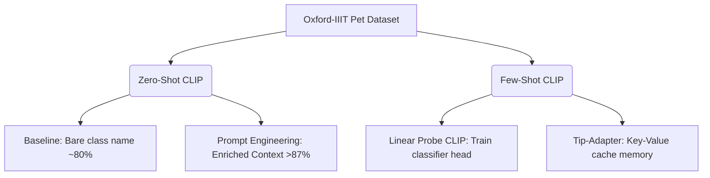

# Xây dựng hệ thống phân loại giống vật nuôi sử dụng mô hình CLIP

Dự án này tập trung vào nghiên cứu, xây dựng và đánh giá hệ thống phân loại giống vật nuôi (37 giống chó và mèo từ tập dữ liệu Oxford-IIIT Pet) sử dụng mô hình ngôn ngữ - hình ảnh đa phương thức CLIP (Contrastive Language-Image Pretraining). Dự án đi từ phương pháp Zero-shot baseline (kết hợp Prompt Engineering) và mở rộng sang các kỹ thuật Few-shot Adaptation (Linear Probe CLIP, Tip-Adapter) nhằm cải thiện độ chính xác và khả năng thích ứng của mô hình trên dữ liệu thực tế.

---

## 1. Mục đích và Mục tiêu

### Mục đích
* **Kiểm chứng khả năng nhận diện zero-shot** của mô hình CLIP trên tập dữ liệu Oxford-IIIT Pet.
* **Đánh giá hiệu suất Prompt Engineering** khi bổ sung thông tin ngữ cảnh (contextual information) thay vì chỉ sử dụng nhãn lớp đơn thuần.
* **Tối ưu hóa khả năng thích nghi thực tế** của mô hình thông qua các kỹ thuật Few-shot Learning, khắc phục hạn chế về độ chính xác của cách tiếp cận Zero-shot truyền thống.

### Mục tiêu
* **Xây dựng pipeline hoàn chỉnh**: Chuyển đổi từ hình ảnh vật nuôi sang các vector embedding để tính toán độ tương đồng cosine với nhãn văn bản.
* **Thiết kế Prompt chất lượng cao**: Thử nghiệm các bộ prompt đa dạng (ví dụ: `"Picture of a pet with breed: [Breed Name], which is a type of [cat/dog]"`) để nâng cao độ chính xác từ mức baseline (~80%) lên trên 87%.
* **Triển khai Few-shot Learning**: Sử dụng một lượng nhỏ dữ liệu có nhãn làm "Support Images" để tinh chỉnh hoặc thích nghi mô hình (Linear Probe CLIP, Tip-Adapter).
* **So sánh và phân tích định lượng**: Đánh giá hiệu quả của các phương pháp (Zero-shot vs. Few-shot) qua các tiêu chí đo lường thực tế.

---

## 2. Định hướng cải tiến (Zero-Shot vs. Few-Shot Adaptation)

Dự án chuyển dịch từ hướng tiếp cận Zero-shot thuần túy sang cấu trúc thích ứng đa dạng hơn:

### Các phương pháp so sánh
1. **ResNet (Baseline truyền thống)**: Mô hình mạng CNN phân loại được huấn luyện từ đầu hoặc fine-tune toàn bộ trọng số làm mốc so sánh cổ điển.
2. **CLIP Zero-shot**: Sử dụng mô hình CLIP đóng băng (Frozen Backbone), phân loại trực tiếp qua similarity của image embedding và prompt text embedding.
3. **CLIP + Linear Probe**: Đóng băng CLIP Image Encoder, huấn luyện một bộ phân loại tuyến tính (Linear Classifier) trên các embedding thu được từ tập dữ liệu Support (few-shot).
4. **CLIP + Tip-Adapter**: Xây dựng bộ nhớ cache dạng Key-Value từ các ảnh support nhằm điều chỉnh kết quả dự đoán Zero-shot mà không cần huấn luyện lại hoặc chỉ cần cập nhật trọng số rất nhẹ (Tip-Adapter-F).

---

## 3. Khung đánh giá hiệu năng (Evaluation Framework)

Hệ thống được đánh giá một cách toàn diện dựa trên 4 tiêu chí chính, được quy định chi tiết trong cấu trúc `.agent/criteria/`:

| Tiêu chí | Mô tả | Phương pháp thực hiện |
| :--- | :--- | :--- |
| **Acc per shot** | Độ chính xác theo số mẫu hỗ trợ | Đánh giá trên các mốc: 1-shot, 2-shot, 4-shot, 8-shot, 16-shot. |
| **Confidence Interval** | Khoảng tin cậy thống kê của Accuracy | Sử dụng kỹ thuật Bootstrapping (95% CI) trên tập test. |
| **Inference Latency** | Độ trễ suy diễn trên từng ảnh | Đo lường thời gian xử lý trung bình và các phân vị (p50, p95, p99) trên cả CPU và GPU. |
| **Confusion Matrix** | Ma trận nhầm lẫn | Phân tích các giống vật nuôi dễ nhầm lẫn trong cùng loài hoặc chéo loài. |

---

## 4. Cấu trúc thư mục Agent hướng dẫn cấu hình

Dự án tích hợp bộ khung cấu hình Agent tại `.agent/` để định hướng hoạt động cho các mô hình AI hoặc kỹ sư tham gia phát triển:

* **Rules (`.agent/rules/`)**: Quy định lập trình và quy chuẩn cấu trúc mã nguồn.
* **Skills (`.agent/skills/`)**: Hướng dẫn kỹ thuật lập trình các thuật toán Zero-shot, Linear Probe và Tip-Adapter.
* **Workflows (`.agent/workflows/`)**: Quy trình các bước thực nghiệm, từ chuẩn bị dữ liệu đến sinh báo cáo so sánh.
* **Criteria (`.agent/criteria/`)**: Các tệp đặc tả chi tiết về cách đo lường các chỉ số hiệu năng (accuracy per shot, confidence interval, latency, confusion matrix).