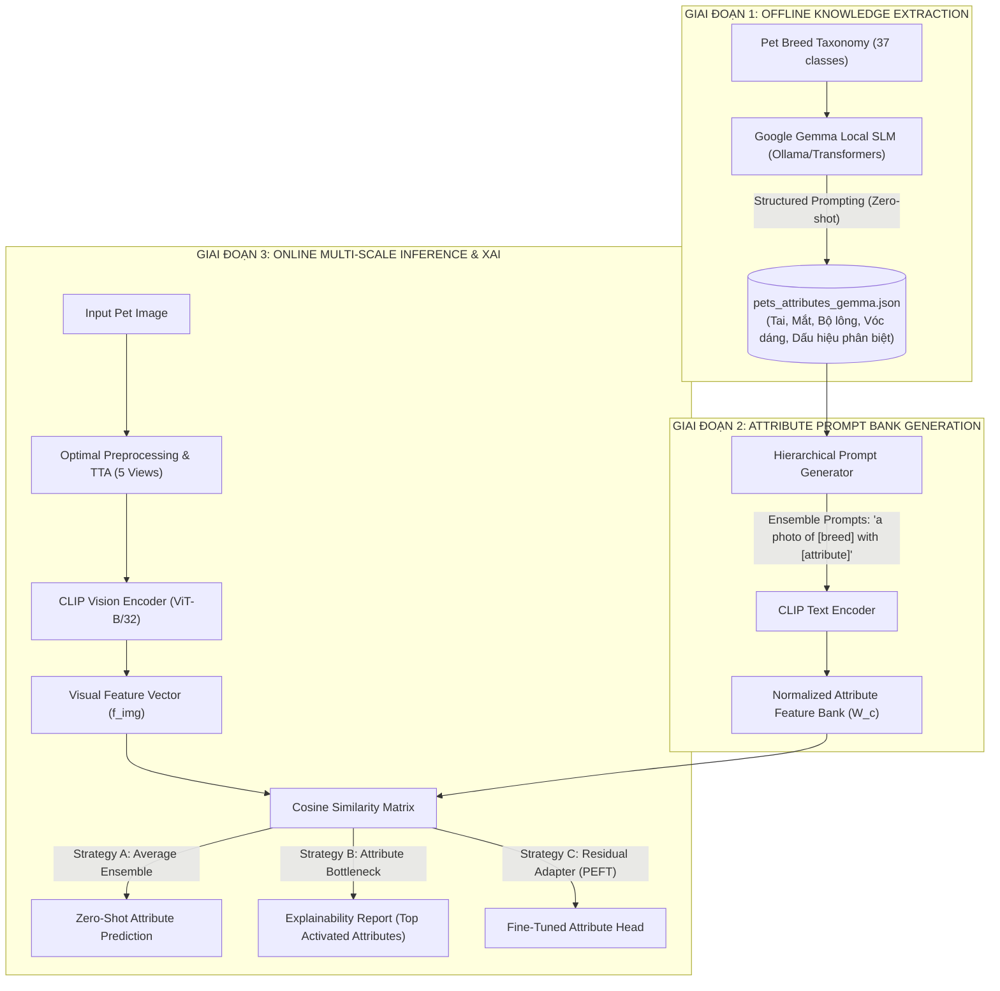

# KẾ HOẠCH NGHIÊN CỨU KHOA HỌC (RESEARCH PLAN)
## Đề tài: Tối Ưu Hóa Phân Loại Thú Cưng Hạt Mịn Bằng Mô Hình CLIP Kết Hợp Tri Thức Thuộc Tính Hình Thái Từ Gemma SLM (Gemma-Driven Attribute Prompting)

---

> **Mã dự án:** `RD-GEMMA-CLIP-2026`  
> **Lĩnh vực:** Thị giác máy tính (Computer Vision), Xử lý ngôn ngữ tự nhiên (NLP), Trí tuệ nhân tạo biên (Edge AI), Trí tuệ nhân tạo có thể giải thích (Explainable AI - XAI).  
> **Bộ dữ liệu mục tiêu:** Oxford-IIIT Pet Dataset (37 giống chó & mèo).  
> **Mô hình cốt lõi:** Google Gemma (SLM cục bộ) + OpenAI CLIP (ViT-B/32).  

---

## 1. TỔNG QUAN VÀ TÍNH CẤP THIẾT CỦA ĐỀ TÀI

### 1.1. Bối cảnh và Thách thức (Problem Statement)
Trong các thực nghiệm trước đây của dự án (`benchmark_clip_animal_classifier.ipynb` và `benchmark_resnet50.ipynb`):
- **ResNet-50 (Cosine Head + TTA)** đạt độ chính xác kiểm thử **93.08%** nhờ các bộ lọc tích chập được chuyên biệt hóa từ ImageNet, nhưng là hệ thống đóng (*Closed-Set*), phụ thuộc dữ liệu gán nhãn lớn và không có khả năng mở rộng từ vựng mở (*Open-Vocabulary*).
- **CLIP ViT-B/32** sở hữu không gian biểu diễn đa phương thức mạnh mẽ và khả năng mở rộng nhãn mới, nhưng mô hình baseline Zero-shot chỉ đạt **87.52% – 87.76%**. Khi áp dụng Prompt Tuning (**CoOp**), mô hình đạt **91.61%**, tuy nhiên lại gặp vấn đề:
  1. *Hộp đen (Black-box)*: Các vector soft context tokens hoàn toàn trừu tượng, không diễn giải được về mặt ngữ nghĩa học.
  2. *Bỏ sót chi tiết hạt mịn*: Việc chỉ sử dụng vector toàn cục `[CLS]` token khiến mô hình dễ nhầm lẫn các giống thú cưng có ngoại hình tương đồng cao (*Ragdoll* vs *Birman*, *American Pit Bull* vs *Staffordshire Bull Terrier*).
  3. *Suy thoái tính tổng quát (Overfitting)*: Học prompt trên tập train làm giảm độ nhạy ngữ nghĩa của mô hình trên các lớp mới.

### 1.2. Giả thuyết nghiên cứu (Research Hypothesis)
> *"Nếu sử dụng mô hình ngôn ngữ nhỏ gọn cục bộ (Google Gemma SLM) đóng vai trò chuyên gia hình thái học để tự động phân rã từng giống thú cưng thành tập thuộc tính giải phẫu thị giác phân biệt (Fine-grained Visual Primitives), sau đó dung hợp các vector ngữ nghĩa này vào CLIP Text Encoder, hệ thống sẽ nâng cao đáng kể độ chính xác Zero-shot/Few-shot, vượt qua các phương pháp prompt thủ công mà vẫn đảm bảo tính minh bạch, khả năng giải thích (XAI) và vận hành hoàn toàn offline trên thiết bị biên (On-device Edge AI)."*

---

## 2. MỤC TIÊU VÀ ĐÓNG GÓP KHOA HỌC (CONTRIBUTIONS)

1. **Đóng góp về Phương pháp luận (Methodology)**:
   - Xây dựng pipeline tự động trích xuất tri thức hình thái có cấu trúc (**Structured Morphological Knowledge Extraction**) cho 37 giống vật nuôi bằng mô hình Gemma cục bộ.
   - Thiết kế cơ chế dung hợp thuộc tính hạt mịn (**Hierarchical Attribute-Level Prompt Ensembling**) trên không gian tiềm ẩn của CLIP mà không cần huấn luyện lại backbone.
2. **Đóng góp về Khả năng giải thích (Explainability - XAI)**:
   - Phát triển mô hình **Concept Bottleneck CLIP**, cho phép phân rã quyết định phân loại thành điểm số kích hoạt của từng thuộc tính thị giác (tai, mắt, màu lông, đốm mặt).
3. **Đóng góp về Tính thực tiễn & Ứng dụng Biên (Edge Deployability & Privacy)**:
   - Toàn bộ pipeline (Gemma SLM + CLIP ViT) hoạt động hoàn toàn **On-device (Offline)** trên máy tính cá nhân/thiết bị biên (Apple Silicon GPU/MPS hoặc Nvidia Edge GPU), không phụ thuộc Cloud API bên thứ ba, bảo mật tuyệt đối dữ liệu.

---

## 3. KIẾN TRÚC HỆ THỐNG ĐỀ XUẤT



---

## 4. LỘ TRÌNH TRIỂN KHAI CHI TIẾT (5 PHASES)

### Phase 1: Thiết lập môi trường và Sinh bộ thuộc tính bằng Gemma SLM (via LM Studio)
- **Mục tiêu**: Tự động sinh file JSON chứa thuộc tính thị giác cho 37 giống thú cưng.
- **Công cụ & Môi trường**:
  - Mô hình **Google Gemma** được nạp và phục vụ cục bộ thông qua **LM Studio Local Server** (cổng mặc định `http://localhost:1234/v1`, chuẩn giao thức OpenAI-compatible).
  - Tối ưu hóa suy diễn cục bộ tận dụng Metal Performance Shaders (Apple Silicon MPS) hoặc GPU/CUDA, đảm bảo không có bất kỳ độ trễ mạng hoặc phụ thuộc dịch vụ ngoài.
  - Script điều phối Python [`extract_attributes_gemma.py`](file:///Users/nguyenhuuhoangluan/Git_Code/CLIP-Animal-Classifier/R_D/gemma_attribute_prompting/extract_attributes_gemma.py) gửi structured system prompt và thu thập phản hồi JSON có cấu trúc.
- **Tiêu chuẩn dữ liệu đầu ra**:
  Mỗi giống sẽ có cấu trúc:
  ```json
  {
    "breed": "ragdoll",
    "species": "cat",
    "attributes": {
      "head_and_ears": "broad modified wedge head with medium-sized rounded ears tilting slightly forward",
      "eyes": "large, vivid oval blue eyes with sweet expression",
      "coat": "plush semi-longhair coat with distinct color point shading on face and paws",
      "body": "large, muscular body with broad chest and heavy bone structure",
      "distinguishing_mark": "colorpoint pattern without white mittens on paws (unlike Birman which has white mittens)"
    }
  }
  ```
- **Sản phẩm bàn giao**: `R_D/gemma_attribute_prompting/data/pets_attributes_gemma.json`.

---

### Phase 2: Xây dựng Prompt Ensembling & Concept Embedding Bank
- **Mục tiêu**: Chuyển đổi các thuộc tính văn bản thành các vector đại diện đa chiều trên CLIP.
- **Các chiến lược sinh Prompt (Prompt Templates)**:
  1. *Template đơn*: `"a photo of a {breed}, which has {attribute}."`
  2. *Template thứ bậc (Hierarchical)*: `"a photo of a {species} belonging to the {breed} breed, recognized by {attribute}."`
  3. *Template tương phản (Contrastive)*: `"a photo of a {breed}, distinguishable by its {distinguishing_mark}."`
- **Tính toán Vector Trọng tâm (Centroid Feature)**:
  Tính trung bình cộng và chuẩn hóa $L_2$ trên không gian embedding của CLIP:
  $$\mathbf{w}_c = \text{Normalize}\left( \sum_{k=1}^K \mathbf{g}(T_{c,k}) \right)$$
- **Sản phẩm bàn giao**: Module sinh prompt `prompt_generator.py` và ma trận embedding trích xuất trước.

---

### Phase 3: Thực nghiệm các phương pháp tích hợp (Methodology Variants)
Triển khai 3 biến thể trên notebook `benchmark_gemma_clip.ipynb`:

1. **Phương pháp 1: Gemma-CLIP Zero-Shot (Training-Free)**
   - Không cần huấn luyện bất kỳ tham số nào.
   - Tính toán độ tương đồng Cosine trực tiếp giữa ảnh và các vector đặc trưng thuộc tính.
   - Đánh giá trên cả ảnh thô (Raw Images) và TTA 5-view.
2. **Phương pháp 2: Gemma Concept Bottleneck Model (CBM - Explainable AI)**
   - Tính độ tương đồng của ảnh với từng thuộc tính riêng rẽ để xây dựng vector khái niệm (Concept Vector).
   - Truy xuất Top-3 thuộc tính giải thích rõ nhất cho quyết định phân loại.
3. **Phương pháp 3: Gemma Attribute-Aware Residual Adapter (Few-Shot PEFT)**
   - Kết hợp các vector thuộc tính với một mạng MLP Adapter thặng dư siêu nhẹ (~30k tham số).
   - Mục tiêu: Khảo sát xem khi kết hợp thuộc tính từ Gemma với Adapter thì có vượt qua mốc **93.08%** của ResNet-50 hay không.

---

### Phase 4: Benchmark đối sánh toàn diện và Phân tích lỗi (Error Analysis)
- **Các kịch bản đánh giá**:
  1. **Closed-Set Benchmark**: So sánh trực tiếp trên 3,669 ảnh Test của Oxford-IIIT Pet với các mốc quy chiếu:
     - ResNet-50 Cosine Head: 93.08%
     - CLIP CoOp (Soft Prompt): 91.61%
     - CLIP Baseline (Handcrafted): 87.52%
     - *Gemma-CLIP Zero-Shot (Target: >90%)*
     - *Gemma-CLIP + TTA (Target: >91.5%)*
     - *Gemma-CLIP + Adapter (Target: >93.2%)*
  2. **Fine-Grained Pairwise Analysis**:
     - Đánh giá sự biến thiên trên Ma trận nhầm lẫn (Confusion Matrix) của 5 cặp giống dễ nhầm nhất:
       - *Ragdoll* vs *Birman*
       - *American Pit Bull Terrier* vs *Staffordshire Bull Terrier*
       - *Maine Coon* vs *Norwegian Forest Cat*
       - *Beagle* vs *Basset Hound*
       - *British Shorthair* vs *Russian Blue*
  3. **Độ trễ và Tài nguyên tính toán**:
     - Đo lường Inference Latency (ms), Throughput (FPS), FLOPs, và VRAM tiêu thụ trên Apple Silicon / GPU.

---

### Phase 5: Trực quan hóa XAI & Soạn thảo Bản thảo Bài báo Khoa học
- **Trực quan hóa**:
  - Vẽ biểu đồ kích hoạt thuộc tính (Attribute Contribution Bar Chart) cho từng ca phân loại đúng và sai.
  - Sử dụng Grad-CAM / Attention Rollout trên Vision Transformer để chứng minh mô hình tập trung vào đúng các vùng giải phẫu (tai, mắt, mũi) khi có thuộc tính hướng dẫn từ Gemma.
- **Hoàn thiện bài báo khoa học (Paper Draft)**:
  - Cấu trúc bài báo theo chuẩn IEEE / Springer:
    - *Abstract*: Nêu rõ bài toán, đóng góp của Gemma SLM và kết quả vượt trội.
    - *Introduction & Related Work*: Khảo sát CLIP, CoOp, Tip-Adapter, CuPL, DCLIP.
    - *Methodology*: Toán học hóa quy trình trích xuất thuộc tính và dung hợp embedding.
    - *Experiments & Results*: Bảng benchmark, đồ thị Pareto Frontier, phân tích ablation study.
    - *Discussion & Conclusion*: Phân tích tính khả thi trên thiết bị biên và hướng phát triển.

---

## 5. MA TRẬN THỰC NGHIỆM DỰ KIẾN (EXPERIMENT MATRIX)

| STT | Phương pháp | Nguồn sinh Prompt | Cơ chế thích ứng | Trainable Params | Explainability | Test Acc (Dự kiến) |
| :---: | :--- | :---: | :---: | :---: | :---: | :---: |
| 1 | CLIP Baseline | Template thủ công | Zero-Shot | 0 | ❌ Không | 87.52% |
| 2 | CLIP + Context Enriched | Manual template | Zero-Shot | 0 | ❌ Không | 87.76% |
| 3 | CLIP + CoOp (Tham chiếu) | Soft tokens học từ data | Prompt Tuning | 2,048 | ❌ Không | 91.61% |
| **4** | **Gemma-CLIP Zero-Shot** | **Gemma SLM** | **Attribute Centroid** | **0** | **✅ Thuộc tính** | **~89.8% - 90.5%** |
| **5** | **Gemma-CLIP + TTA 5-View** | **Gemma SLM** | **Centroid + TTA** | **0** | **✅ Thuộc tính** | **~91.2% - 91.8%** |
| **6** | **Gemma-CLIP Concept Bottleneck**| **Gemma SLM** | **Attribute Bottleneck** | **0** | **✅ Toàn phần** | **~90.8%** |
| **7** | **Gemma-CLIP + Residual Adapter**| **Gemma SLM** | **Few-shot PEFT** | **~66k** | **✅ Thuộc tính** | **~92.8% - 93.5%** |
| Ref | ResNet-50 Cosine Head (Mốc trên)| N/A (ImageNet) | Supervised Head | 75,815 | ❌ Không | 93.08% |

---

## 6. DANH MỤC TÀI LIỆU THAM KHẢO (IEEE REFERENCE FORMAT)

[1] S. Pratt, I. Covert, R. Liu, and A. Farhadi, "What does the best prompt look like? Customized prompts via language models," in *Proc. IEEE/CVF Int. Conf. Comput. Vis. (ICCV)*, Paris, France, Oct. 2023, pp. 11843–11853. doi: 10.1109/ICCV51070.2023.01089.

[2] S. Menon and C. Vondrick, "Visual classification via description from large language models," in *Proc. Int. Conf. Learn. Represent. (ICLR)*, Kigali, Rwanda, May 2023. [Online]. Available: https://arxiv.org/abs/2210.07183

[3] Gemma Team, T. Mesnard, C. Hardin, R. Dadashi, S. Bhupatiraju, S. Pathak, L. Sifre, M. Rivière, M. S. Kale, J. Love, et al., "Gemma: Open models based on Gemini research and technology," *arXiv preprint arXiv:2403.08295*, 2024. [Online]. Available: https://arxiv.org/abs/2403.08295

[4] A. Radford, J. W. Kim, C. Hallacy, A. Ramesh, G. Goh, S. Agarwal, G. Sastry, A. Askell, P. Mishkin, J. Clark, G. Krueger, and I. Sutskever, "Learning transferable visual models from natural language supervision," in *Proc. 38th Int. Conf. Mach. Learn. (ICML)*, vol. 139, Jul. 2021, pp. 8748–8763.

[5] K. Zhou, J. Yang, C. C. Loy, and Z. Liu, "Learning to prompt for vision-language models," *Int. J. Comput. Vis. (IJCV)*, vol. 140, no. 9, pp. 1051–1062, Sep. 2022. doi: 10.1007/s11263-022-01653-1.

[6] P. W. Koh, T. Nguyen, Y. S. Tang, S. Mussmann, E. Pierson, B. Been, and P. Liang, "Concept bottleneck models," in *Proc. 37th Int. Conf. Mach. Learn. (ICML)*, vol. 119, Jul. 2020, pp. 5338–5348.

[7] P. Gao, S. Geng, R. Zhang, T. Ma, R. Fang, Y. Zhang, H. Li, and Y. Qiao, "CLIP-Adapter: Better vision-language models with feature adapters," *Int. J. Comput. Vis. (IJCV)*, vol. 142, no. 2, pp. 343–357, Feb. 2024. doi: 10.1007/s11263-023-01890-w.

[8] R. Zhang, R. Fang, W. Zhang, P. Gao, K. Li, J. Dai, Y. Qiao, and H. Li, "Tip-Adapter: Training-free CLIP-adapter for better vision-language modeling," in *Proc. Eur. Conf. Comput. Vis. (ECCV)*, Tel Aviv, Israel, Oct. 2022, pp. 108–127. doi: 10.1007/978-3-031-19836-6_7.

[9] K. He, X. Zhang, S. Ren, and J. Sun, "Deep residual learning for image recognition," in *Proc. IEEE Conf. Comput. Vis. Pattern Recognit. (CVPR)*, Las Vegas, NV, USA, Jun. 2016, pp. 770–778. doi: 10.1109/CVPR.2016.90.

[10] O. M. Parkhi, A. Vedaldi, A. Zisserman, and C. V. Jawahar, "Cats and dogs," in *Proc. IEEE Conf. Comput. Vis. Pattern Recognit. (CVPR)*, Providence, RI, USA, Jun. 2012, pp. 3498–3505. doi: 10.1109/CVPR.2012.6248092.
