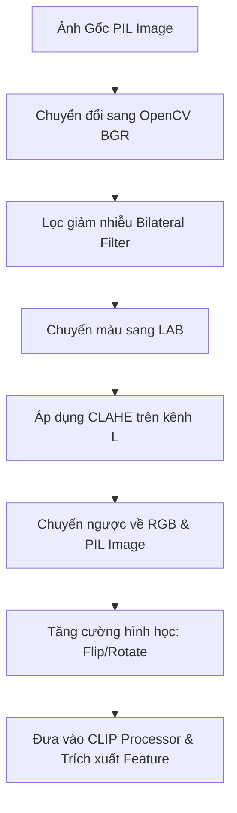

# Tóm Tắt Quy Trình Tiền Xử Lý và Tăng Cường Dữ Liệu (Preprocessing & Data Augmentation Pipeline)

Dựa trên kết quả phân tích **Histogram toàn cục** của tập dữ liệu **Oxford-IIIT Pet** (ảnh có dải động rộng nhưng độ sáng lệch trung bình-cao, nhiều chi tiết màu ấm của lông thú cưng trên nền cỏ xanh, và có sự phân bổ tương phản không đều), chúng tôi thiết kế một pipeline tiền xử lý và tăng cường dữ liệu tối ưu kết hợp giữa xử lý ảnh cổ điển (OpenCV) và tăng cường hình học (Pillow/PyTorch).

---

## 1. Các Kỹ Thuật Tiền Xử Lý Chính (Dựa trên Histogram)

### A. Lọc Giảm Nhiễu Song Phương (Bilateral Filter)
*   **Lý do lựa chọn:** Ảnh chụp thực tế thường chứa nhiễu hạt (sensor noise) ở các vùng nền hoặc trên lông mịn. Lọc Gaussian thông thường sẽ làm mờ các cạnh sắc nét.
*   **Nguyên lý:** Lọc song phương sử dụng cả khoảng cách không gian (spatial distance) và chênh lệch cường độ pixel (intensity difference) để tính trọng số.
*   **Tác dụng:** Làm mịn các vùng có màu sắc đồng nhất (giảm nhiễu nền) trong khi bảo tồn nguyên vẹn các đường biên sắc nét (như ria mép, mắt, và ranh giới lông của thú cưng).
*   **Tham số sử dụng:** `d = 9` (kích thước lân cận), `sigmaColor = 75` (độ nhạy màu), `sigmaSpace = 75` (độ nhạy không gian).

### B. Cân Bằng Histogram Thích Ứng Giới Hạn Tương Phản (CLAHE)
*   **Lý do lựa chọn:** Histogram toàn cục chỉ ra rằng nhiều ảnh có độ tương phản bị nén ở dải giữa, làm mờ đi các chi tiết kết cấu sợi lông (texture).
*   **Nguyên lý:** Khác với cân bằng histogram toàn cục (Global HE) dễ gây cháy sáng hoặc tối cục bộ, CLAHE chia ảnh thành các lưới nhỏ ($8 \times 8$), cân bằng cục bộ và giới hạn độ dốc tương phản (clip limit) để tránh khuếch đại nhiễu ở vùng đồng nhất.
*   **Không gian màu LAB:** Để tránh làm sai lệch màu sắc tự nhiên của thú cưng, chúng tôi chuyển ảnh từ RGB sang không gian màu **LAB**, chỉ áp dụng CLAHE lên kênh **L (Luminance - Độ sáng)**, sau đó ghép lại và chuyển ngược về RGB.
*   **Tham số sử dụng:** `clipLimit = 2.0`, `tileGridSize = (8, 8)`.

---

## 2. Các Kỹ Thuật Tăng Cường Dữ Liệu Hình Học & Màu Sắc

Để cải thiện tính tổng quát hóa của mô hình CLIP (tránh overfit vào góc chụp, hướng đứng và ánh sáng cụ thể), các phép biến đổi sau được áp dụng:

1.  **Lật ngang ngẫu nhiên (Random Horizontal Flip):** Nhân bản dữ liệu đối xứng, giúp mô hình nhận diện vật nuôi ở cả hai hướng quay trái/quay phải.
2.  **Xoay ngẫu nhiên (Random Rotation):** Xoay nhẹ ảnh một góc từ $-15^\circ$ đến $+15^\circ$ để mô hình bất biến với góc nghiêng của camera.
3.  **Tăng cường độ sáng/tương phản ngẫu nhiên (Color Jitter):** Tự động dịch chuyển phân phối histogram sang trái/phải (độ sáng) hoặc kéo dãn/thu hẹp (tương phản) mô phỏng các điều kiện thời tiết hoặc ánh sáng phòng khác nhau.

---

## 3. Sơ Đồ Pipeline Xử Lý (Implementation Flow)

Quy trình xử lý một ảnh từ Dataset đi qua các bước sau:

Pipeline này đảm bảo ảnh đầu vào của mô hình CLIP vừa sạch nhiễu, rõ nét kết cấu sợi lông, vừa đa dạng về mặt hình học để tối ưu hóa hiệu năng phân loại Zero-Shot.
