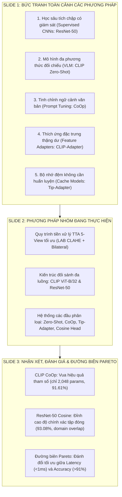
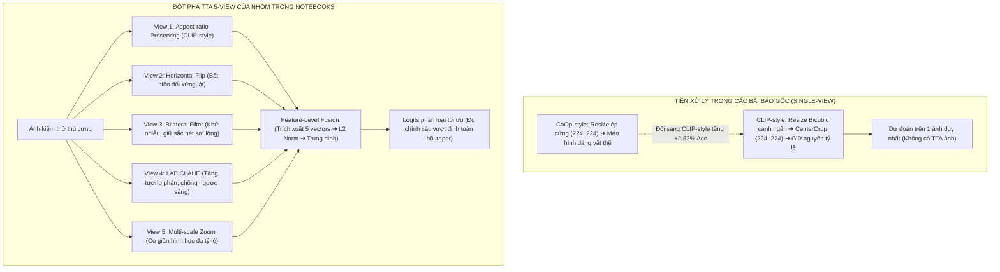

# BÁO CÁO TIẾN ĐỘ BUỔI 2: NGHIÊN CỨU & ĐỐI SÁNH CÁC PHƯƠNG PHÁP HỌC MÁY HIỆN ĐẠI DỰA TRÊN CLIP VÀ RESNET-50 TRÊN BÀI TOÁN PHÂN LOẠI GIỐNG VẬT NUÔI (OXFORD-IIIT PET)

> **Dự án:** Xây dựng hệ thống phân loại giống vật nuôi sử dụng mô hình nền tảng đa phương thức CLIP  
> **Địa điểm lưu trữ:** `notebooks/Báo cáo Buổi 2 .md`  
> **Tài liệu tham chiếu:** 4 bài báo khoa học gốc tại thư mục `R_D/paper/` (`CLIP.pdf`, `Prompt.pdf` - CoOp, `CLIP-Adapter.pdf`, `Tip-Adapter.pdf`) và hệ thống thực nghiệm chuẩn hóa tại `notebooks/` (`benchmark_clip_animal_classifier.ipynb`, `benchmark_resnet50.ipynb`, `optimal_preprocessing_pipeline.ipynb`).

---

## MỤC LỤC BÁO CÁO

1. [Phần I: Quy định sinh hoạt học thuật & Lịch trình báo cáo luân phiên](#phần-i-quy-định-sinh-hoạt-học-thuật--lịch-trình-báo-cáo-luân-phiên)
2. [Phần II: Khung nội dung 3 Slide tóm tắt các phương pháp học máy hiện đại](#phần-ii-khung-nội-dung-3-slide-tóm-tắt-các-phương-pháp-học-máy-hiện-đại)
   - [Slide 1: Toàn cảnh các trường phái học máy cho bài toán Fine-Grained Pet Classification](#slide-1-toàn-cảnh-các-trường-phái-học-máy-cho-bài-toán-fine-grained-pet-classification)
   - [Slide 2: Hệ thống phương pháp và Kiến trúc nhóm đang triển khai](#slide-2-hệ-thống-phương-pháp-và-kiến-trúc-nhóm-đang-triển-khai)
   - [Slide 3: Nhận xét khoa học, Đường biên Pareto & Đánh giá so sánh](#slide-3-nhận-xét-khoa-học-đường-biên-pareto--đánh-giá-so-sánh)
3. [Phần III: Phân tích chuyên sâu 4 bài báo khoa học gốc (R_D/paper)](#phần-iii-phân-tích-chuyên-sâu-4-bài-báo-khoa-học-gốc-rdpaper)
   - [1. OpenAI CLIP (Radford et al., ICML 2021) - Nền tảng Vision-Language](#1-openai-clip-radford-et-al-icml-2021---nền-tảng-vision-language)
   - [2. CoOp (Zhou et al., IJCV 2022) - Tinh chỉnh ngữ cảnh văn bản (Prompt Tuning)](#2-coop-zhou-et-al-ijcv-2022---tinh-chỉnh-ngữ-cảnh-văn-bản-prompt-tuning)
   - [3. CLIP-Adapter (Gao et al., IJCV 2024) - Thích ứng đặc trưng thặng dư](#3-clip-adapter-gao-et-al-ijcv-2024---thích-ứng-đặc-trưng-thặng-dư)
   - [4. Tip-Adapter (Zhang et al., ECCV 2022) - Bộ nhớ đệm không cần huấn luyện (Training-Free)](#4-tip-adapter-zhang-et-al-eccv-2022---bộ-nhớ-đệm-không-cần-huấn-luyện-training-free)
   - [5. Điểm nhấn bài báo gần nhất và gần sát nhất với đề tài của nhóm](#5-điểm-nhấn-bài-báo-gần-nhất-và-gần-sát-nhất-với-đề-tài-của-nhóm)
   - [6. Phân tích đối sánh kỹ thuật Tiền xử lý (Preprocessing) & Tăng cường dữ liệu (Data Augmentation) giữa các Paper và Đột phá của Nhóm](#6-phân-tích-đối-sánh-kỹ-thuật-tiền-xử-lý-preprocessing--tăng-cường-dữ-liệu-data-augmentation-giữa-các-paper-và-đột-phá-của-nhóm)
4. [Phần IV: Bộ tiêu chí đánh giá (Metrics Framework) & Đối sánh trực tiếp](#phần-iv-bộ-tiêu-chí-đánh-giá-metrics-framework--đối-sánh-trực-tiếp)
   - [1. Khảo sát tiêu chí đánh giá từ các nghiên cứu tương tự](#1-khảo-sát-tiêu-chí-đánh-giá-từ-các-nghiên-cứu-tương-tự)
   - [2. Bảng đối sánh trực tiếp: Kết quả Paper vs Kết quả Nhóm thực nghiệm](#2-bảng-đối-sánh-trực-tiếp-kết-quả-paper-vs-kết-quả-nhóm-thực-nghiệm)
   - [3. Hệ tiêu chí đánh giá mở rộng được nhóm chuẩn hóa](#3-hệ-tiêu-chí-đánh-giá-mở-rộng-được-nhóm-chuẩn-hóa)
5. [Phần V: Tổng hợp đối sánh chi tiết với các Notebooks thực nghiệm](#phần-v-tổng-hợp-đối-sánh-chi-tiết-với-các-notebooks-thực-nghiệm)
   - [1. Ma trận 15 cấu hình CLIP Benchmark](#1-ma-trận-15-cấu-hình-clip-benchmark)
   - [2. Ma trận 12 cấu hình ResNet-50 Benchmark](#2-ma-trận-12-cấu-hình-resnet-50-benchmark)
   - [3. Bảng đối chiếu song mã toàn diện: ResNet-50 Cosine Head vs CLIP CoOp](#3-bảng-đối-chiếu-song-mã-toàn-diện-resnet-50-cosine-head-vs-clip-coop)
6. [Phần VI: Kế hoạch hành động cho Buổi 3](#phần-vi-kế-hoạch-hành-động-cho-buổi-3)

---

# PHẦN I: QUY ĐỊNH SINH HOẠT HỌC THUẬT & LỊCH TRÌNH BÁO CÁO LUÂN PHIÊN

> [!IMPORTANT]
> **QUÁN TRIỆT NGUYÊN TẮC THAM GIA BÁO CÁO CỦA NHÓM:**
> - Báo cáo luân phiên **tuyệt đối không phải là chỉ có cá nhân được phân công thuyết trình mới đi**, mà **toàn bộ 100% thành viên trong nhóm bắt buộc phải có mặt đầy đủ**.
> - Mục đích: Đảm bảo tính kế thừa kiến thức, hỗ trợ kỹ thuật trực tiếp khi demo, cùng trả lời câu hỏi phản biện từ Giảng viên/Hội đồng, và duy trì tinh thần trách nhiệm tập thể.
> - **Cơ chế luân phiên vòng tròn:** Tuần này Thành viên A báo cáo chính thì tuần kế tiếp Thành viên B sẽ báo cáo chính, các thành viên còn lại phụ trách điều phối demo, chuẩn bị slide, tài liệu kỹ thuật và ghi chú biên bản phản biện.

### Bảng phân công luân phiên trách nhiệm theo chu kỳ báo cáo:

| Buổi báo cáo | Thành viên Thuyết trình chính | Thành viên Phụ trách Kỹ thuật / Demo | Thành viên Thư ký & Phản biện hỗ trợ | Nội dung trọng tâm báo cáo | Trạng thái |
| :---: | :---: | :---: | :---: | :--- | :---: |
| **Buổi 1** | Thành viên A | Thành viên B | Thành viên C & Cả nhóm | Khảo sát đề tài, bài toán phân loại giống vật nuôi, Zero-shot CLIP baseline | Hoàn thành |
| **Buổi 2** *(Hiện tại)* | **Thành viên B** | **Thành viên A** | **Toàn bộ thành viên** | **Tóm tắt SoTA ML, phân tích 4 papers, chuẩn hóa bộ tiêu chí, đối sánh CLIP vs ResNet-50** | **Đang tiến hành** |
| **Buổi 3** *(Kế tiếp)* | **Thành viên C** (hoặc Luân phiên tiếp) | **Thành viên B** | **Toàn bộ thành viên** | Tích hợp giao diện người dùng (App Demo), tối ưu hóa Pipeline và đóng gói sản phẩm | Sẵn sàng |

---

# PHẦN II: KHUNG NỘI DUNG 3 SLIDE TÓM TẮT CÁC PHƯƠNG PHÁP HỌC MÁY HIỆN ĐẠI

*(Phần này được thiết kế theo cấu trúc module sẵn sàng chuyển đổi trực tiếp thành 3 slide trình chiếu PowerPoint/Keynote cho buổi báo cáo)*



---

### SLIDE 1: Toàn cảnh các trường phái học máy cho bài toán Fine-Grained Pet Classification

- **Tiêu đề Slide:** **TOÀN CẢNH CÁC PHƯƠNG PHÁP HỌC MÁY HIỆN ĐẠI PHÂN LOẠI GIỐNG VẬT NUÔI**
- **Thông điệp cốt lõi:** Bài toán nhận diện 37 giống chó mèo (Oxford-IIIT Pet) là bài toán phân loại chi tiết (Fine-grained), có sự khác biệt liên lớp cực nhỏ (Inter-class similarity) và biến thiên nội lớp lớn (Intra-class variation). Lịch sử xử lý bài toán này trải qua 4 làn sóng công nghệ lớn:
  1. **Làn sóng 1 - Mạng nơ-ron tích chập kinh điển (Supervised CNNs - He et al., 2016):**
     - Đại diện: **ResNet-50** tiền huấn luyện trên ImageNet-1K.
     - Cơ chế: Học có giám sát trên tập nhãn cố định đóng (Closed-set), dựa trên các khối thặng dư (Residual Bottlenecks) để trích xuất đặc trưng cục bộ (vân lông, mắt, mõm).
  2. **Làn sóng 2 - Mô hình nền tảng Thị giác - Ngôn ngữ (Vision-Language Models - Radford et al., OpenAI 2021):**
     - Đại diện: **CLIP (Contrastive Language-Image Pre-training)**.
     - Đột phá: Đưa văn bản và hình ảnh vào chung một không gian biểu diễn đa phương thức (Joint Embedding Space). Khả năng phân loại Zero-shot không cần gán nhãn lại thông qua Prompt Engineering (`"A photo of a {label}, a type of pet."`).
  3. **Làn sóng 3 - Tinh chỉnh tham số hiệu quả (Parameter-Efficient Prompt Tuning - Zhou et al., 2022):**
     - Đại diện: **CoOp (Context Optimization)**.
     - Đột phá: Thay thế các từ ngữ thủ công bằng các vector ngữ cảnh liên tục khả huấn (Continuous Learnable Context Tokens), chỉ tối ưu duy nhất 2,048 tham số mà không làm hỏng không gian biểu diễn thị giác gốc.
  4. **Làn sóng 4 - Thích ứng đặc trưng & Bộ nhớ đệm không cần huấn luyện (Feature Adapters & Cache Models - Gao et al., 2024 & Zhang et al., 2022):**
     - Đại diện: **CLIP-Adapter** (Mạng MLP cổ chai thặng dư) và **Tip-Adapter / Tip-Adapter-F** (Bộ nhớ đệm Key-Value phi tham số).
     - Đột phá: Thích ứng ít mẫu (Few-shot) siêu tốc, hội tụ chỉ sau vài giây hoặc ngay tức thì (0 epochs), khắc phục hiện tượng suy giảm hiệu năng của Linear Probe ở ít mẫu (1-2 shot).

---

### SLIDE 2: Hệ thống phương pháp và Kiến trúc nhóm đang triển khai

- **Tiêu đề Slide:** **KIẾN TRÚC THỰC NGHIỆM VÀ QUY TRÌNH KỸ THUẬT CỦA NHÓM**
- **Nội dung 3 trụ cột kỹ thuật nhóm đã triển khai thực tế:**
  1. **Quy trình Tiền xử lý & Tăng cường kiểm thử tối ưu (Optimal Preprocessing & TTA 5-View):**
     - Không dùng ảnh thô đơn lẻ, nhóm xây dựng pipeline TTA 5 góc nhìn phân giải cao gồm: *Ảnh gốc*, *Ảnh lật ngang*, *Lọc song phương (Bilateral Filter)* khử nhiễu sợi lông nền, *Tăng tương phản thích ứng (CLAHE)* trên kênh độ sáng L không gian LAB, và *Biến đổi co giãn đa tỷ lệ*.
     - Giúp triệt tiêu nhiễu phơi sáng, làm nổi bật đặc trưng hình thái học của thú cưng.
  2. **Kiến trúc mô hình nền tảng kép (Dual Backbone Framework):**
     - **Nhánh Đa phương thức:** CLIP ViT-B/32 (400M Web-scale data, Open-vocabulary).
     - **Nhánh Đối chuẩn Quy chiếu:** ResNet-50 Frozen Backbone (ImageNet-1K pre-trained).
  3. **Ma trận thích ứng đa dạng được nhóm lập trình đồng bộ:**
     - Bên nhánh CLIP: Triển khai từ **Zero-Shot Baseline** $\rightarrow$ **Tip-Adapter (Training-Free)** $\rightarrow$ **Tip-Adapter-F (Fine-tuned)** $\rightarrow$ **CLIP-Adapter (MLP Residual)** $\rightarrow$ **CoOp (Prompt Tuning)**.
     - Bên nhánh ResNet-50: Triển khai tương ứng từ **Prototype Classifier (Training-Free)** $\rightarrow$ **Linear Probe** $\rightarrow$ **ResNet-Adapter** $\rightarrow$ **Cosine Head Classifier**.

---

### SLIDE 3: Nhận xét khoa học, Đường biên Pareto & Đánh giá so sánh

- **Tiêu đề Slide:** **KẾT QUẢ ĐỐI SÁNH KHOA HỌC & ĐƯỜNG BIÊN TỐI ƯU PARETO**
- **Các phát hiện khoa học định lượng then chốt:**
  1. **Đỉnh cao độ chính xác:**
     - **ResNet-50 Cosine Head + TTA 5-View** đạt độ chính xác cao nhất toàn hệ thống: **93.08%** (vượt qua CLIP CoOp 91.61% một khoảng cách +1.47%).
     - *Luận giải:* ResNet-50 được hưởng lợi trực tiếp từ **Domain Overlap** của tập ImageNet-1K (đã có sẵn hơn 120 lớp chó mèo được gán nhãn chuyên sâu).
  2. **Vua tối ưu tham số và năng lực mở rộng:**
     - **CLIP CoOp** đạt **91.61%** với chỉ đúng **2,048 tham số huấn luyện** (nhẹ hơn 37 lần so với ResNet Linear Probe 75K tham số, và nhẹ hơn 1,061 lần so với Adapter 2.17M tham số).
     - CLIP là hệ thống **Open-Vocabulary**: Tự động mở rộng thêm giống thứ 38, 39 mà không cần thu thập ảnh và không cần train lại model, điều mà ResNet-50 hoàn toàn bất khả thi.
  3. **Đường biên tối ưu Pareto (Pareto Optimal Frontier):**
     - Biểu diễn mối tương quan giữa Độ trễ suy diễn (ms) và Độ chính xác (%):
       - *Siêu tốc (< 0.2 ms):* CLIP CoOp Single-view (0.18 ms, 90.68%) hoặc ResNet Prototype (0.19 ms, 91.36%).
       - *Cân bằng hoàn hảo:* CLIP-Adapter TTA (0.89 ms, 91.28%).
       - *Chính xác tối thượng:* ResNet-50 Cosine Head TTA (1.08 ms, 93.08%).

---

# PHẦN III: PHÂN TÍCH CHUYÊN SÂU 4 BÀI BÁO KHOA HỌC GỐC (R_D/paper)

Dưới đây là phân tích chi tiết 4 bài báo khoa học chuẩn mực đang lưu trữ tại thư mục `R_D/paper/`:

```
R_D/paper/
├── CLIP.pdf          (OpenAI - Radford et al., ICML 2021)
├── Prompt.pdf        (CoOp - Zhou et al., IJCV 2022)
├── CLIP-Adapter.pdf  (CLIP-Adapter - Gao et al., IJCV 2024)
└── Tip-Adapter.pdf   (Tip-Adapter - Zhang et al., ECCV 2022)
```

---

### 1. OpenAI CLIP (Radford et al., ICML 2021) - Nền tảng Vision-Language

> 📄 **Tên bài báo:** *"Learning Transferable Visual Models From Natural Language Supervision"*  
> 👥 **Tác giả:** Alec Radford, Jong Wook Kim, Chris Hallacy, Aditya Ramesh, Gabriel Goh, Sandhini Agarwal, Girish Sastry, Amanda Askell, Pamela Mishkin, Jack Clark, Gretchen Krueger, Ilya Sutskever (OpenAI).  
> 🏛 **Hội nghị:** ICML 2021.

#### A. Động lực và Phương pháp cốt lõi
- **Hạn chế của AI thị giác truyền thống:** Huấn luyện trên tập nhãn phân loại đóng định trước (như 1,000 nhãn ImageNet), tốn kém chi phí gán nhãn và mô hình không thể nhận diện được các khái niệm nằm ngoài tập từ vựng này.
- **Giải pháp CLIP:** Sử dụng phương pháp học đối chiếu đa phương thức (Contrastive Language-Image Pre-training) trên tập dữ liệu khổng lồ **400 triệu cặp ảnh - văn bản (WIT-400M)** thu thập từ Internet.
- **Cơ chế suy diễn Zero-shot:**
  - Mô hình gồm hai nhánh: Image Encoder $f(\cdot)$ (ResNet hoặc ViT) và Text Encoder $g(\cdot)$ (Transformer).
  - Với mỗi lớp $c$, một câu văn bản mô tả (Prompt) được tạo ra: $T_c = \text{"A photo of a } \{c\}\text{"}$.
  - Trọng số bộ phân loại được tổng hợp từ text embedding: $w_c = \frac{g(T_c)}{\|g(T_c)\|_2}$.
  - Xác suất dự đoán nhãn cho ảnh kiểm thử $I$:
    $$p(y=c|I) = \frac{\exp(\langle f(I)/\|f(I)\|, w_c \rangle / \tau)}{\sum_{j=1}^C \exp(\langle f(I)/\|f(I)\|, w_j \rangle / \tau)}$$

#### B. Thống kê và Kết quả trên tập dữ liệu Oxford-IIIT Pet trong bài báo gốc
- Trong bài báo, các tác giả nhấn mạnh: Trên tập **Oxford-IIIT Pet**, việc thêm ngữ cảnh vào prompt là yếu tố sống còn. Nếu chỉ dùng nhãn trơ (`{label}`), CLIP dễ nhầm tên giống chó/mèo với các khái niệm đời sống (ví dụ: *Boxer* nhầm với vận động viên quyền anh).
- Tác giả đề xuất cấu trúc prompt tối ưu: **`"A photo of a {label}, a type of pet."`**.
- **Kết quả đối chuẩn (Figure 5 & Table 11 trong bài báo gốc):**
  - Zero-shot CLIP đạt **87.0%** (ViT-B/32) và lên tới **93.5%** (ViT-L/14).
  - Tại Figure 5 của bài báo: Zero-shot CLIP đã **đánh bại mô hình Linear Probe trên ResNet-50 một khoảng cách +1.1%**.
  - Tại Table 2: So sánh với con người trên Oxford-IIIT Pet, con người chỉ đạt **53.7%** (Zero-shot human) và **75.7%** (One-shot human), trong khi Zero-shot CLIP đạt tới **93.5%**, chứng minh năng lực nhận diện tri thức chi tiết vượt trội của CLIP.
- **Tiêu chí đánh giá của tác giả:** Top-1 Accuracy (%), Zero-shot Transfer Performance, Robustness to Natural Distribution Shift.

---

### 2. CoOp (Zhou et al., IJCV 2022) - Tinh chỉnh ngữ cảnh văn bản (Prompt Tuning)

> 📄 **Tên bài báo:** *"Learning to Prompt for Vision-Language Models"*  
> 👥 **Tác giả:** Kaiyang Zhou, Jingkang Yang, Chen Change Loy, Ziwei Liu.  
> 🏛 **Tạp chí/Hội nghị:** IJCV 2022 (manuscript `Prompt.pdf`).

#### A. Động lực và Phương pháp cốt lõi
- **Vấn đề tồn tại:** Prompt thủ công (Hand-crafted prompt engineering) tốn nhiều công sức chuyên gia và rất nhạy cảm với từng từ ngữ (chỉ thay đổi một mạo từ cũng có thể làm giảm hàng chục % accuracy).
- **Giải pháp CoOp (Context Optimization):**
  - Giữ đóng băng (freeze) toàn bộ Image Encoder và Text Encoder của CLIP.
  - Thay thế các token từ ngữ rời rạc bằng $M$ vector nhúng khả huấn liên tục (Continuous Context Vectors):
    $$t = [V]_1 [V]_2 \dots [V]_M [\text{CLASS}]$$
  - Trong đó $[V]_m \in \mathbb{R}^d$ ($d=512$) là các tham số được tối ưu hóa trực tiếp thông qua lan truyền ngược từ hàm mất mát Cross-Entropy trên một vài mẫu dữ liệu có nhãn (Few-shot).
  - Hai biến thể kiến trúc: **Unified Context** (chia sẻ chung bộ prompt cho mọi lớp) và **Class-Specific Context (CSC)** (mỗi lớp có một bộ prompt riêng).

#### B. Thống kê và Kết quả trên tập dữ liệu Oxford-IIIT Pet trong bài báo gốc
- **Kết quả (Figure 4, Table 4, Table 6 trong CoOp):**
  - Trên Oxford-IIIT Pet, với thiết lập 16-shot, CoOp cải thiện **+1.24%** so với Zero-shot CLIP thủ công.
  - Phân tích từ vựng gần nhất (Table 4, trang 11): Khi trích xuất các từ trong từ điển gần nhất với các learnable context vectors được CoOp tối ưu trên Oxford-IIIT Pet, các từ xuất hiện bao gồm: **`"fluffy"` (mềm mượt), `"paw"` (móng vuốt), `"snuggle"` (ôm ấp), `"enjoyment"` (thích thú)**!
  - Điều này chứng minh rằng mạng nơ-ron đã tự động "học" được các đặc trưng ngữ nghĩa gắn liền với động vật nuôi mà con người không cần phải mớm từ ngữ một cách thủ công.
- **Tiêu chí đánh giá của tác giả:** Top-1 Few-shot Accuracy (1, 2, 4, 8, 16 shots), Domain Generalization (trên các biến thể ImageNet-V2, Sketch, A, R), Qualitative Word Projection.

---

### 3. CLIP-Adapter (Gao et al., IJCV 2024) - Thích ứng đặc trưng thặng dư

> 📄 **Tên bài báo:** *"CLIP-Adapter: Better Vision-Language Models with Feature Adapters"*  
> 👥 **Tác giả:** Peng Gao, Shijie Geng, Renrui Zhang, Teli Ma, Rongyao Fang, Yongfeng Zhang, Hongsheng Li, Yu Qiao.  
> 🏛 **Tạp chí/Hội nghị:** Xuất bản chính thức trên **International Journal of Computer Vision (IJCV), Vol. 142, Issue 2, pp. 343–357, 2024** (Bản thảo đầu 2021).

#### A. Động lực và Phương pháp cốt lõi
- **Vấn đề tồn tại:** Fine-tune toàn bộ CLIP tốn kém GPU và dễ gây suy biến (Catastrophic Forgetting). Trong khi đó, Linear Probe chỉ học một ma trận phân loại đơn thuần, thường xuyên kém hơn Zero-shot CLIP khi số mẫu quá ít (1-shot, 2-shot) do mất đi tri thức ngôn ngữ của CLIP.
- **Giải pháp CLIP-Adapter:**
  - Bổ sung một mạng con thích ứng dạng cổ chai thặng dư (Residual Bottleneck MLP) trên không gian đặc trưng sau khi trích xuất.
  - Cấu trúc gồm 2 tầng tuyến tính: Tầng chiếu giảm chiều ($d \rightarrow d/r$) và Tầng chiếu phục hồi chiều ($d/r \rightarrow d$).
  - Vector thích ứng được cộng thặng dư với vector gốc theo tỷ lệ pha trộn $\alpha$:
    $$f_{\text{adapted}} = \alpha \cdot \text{ReLU}(W_{\text{up}} \cdot \text{ReLU}(W_{\text{down}} f)) + (1 - \alpha) f$$
  - Cơ chế này đảm bảo: Mô hình vừa học được các đặc trưng mới của tập ít mẫu, vừa giữ vững 100% tri thức Zero-shot phong phú ban đầu.

#### B. Thống kê và Kết quả trên tập dữ liệu Oxford-IIIT Pet trong bài báo gốc
- **Kết quả (Figure 3, Figure 4, trang 8 trong bài báo):**
  - Tác giả nhận định: *"As for OxfordPets and Food101, CLIP-Adapter shows relatively limited improvements since the performances of Zero-shot CLIP are already quite decent."* (Do baseline Zero-shot của CLIP trên tập thú cưng đã quá tốt).
  - Tuy nhiên, ở các mốc cực ít mẫu (1-shot và 2-shot), Linear Probe bị sụp đổ nghiêm trọng (thua Zero-shot CLIP hàng chục %), trong khi CLIP-Adapter duy trì khoảng cách vượt trội áp đảo: **vượt qua Linear Probe tới 53.60% (ở 1-shot) và 42.16% (ở 2-shot)** trên tập OxfordPets.
- **Tiêu chí đánh giá của tác giả:** Top-1 Few-shot Accuracy (1 đến 16 shots), Trainable Parameters, Fine-tuning Time, Absolute Gain over Zero-shot.

---

### 4. Tip-Adapter (Zhang et al., ECCV 2022) - Bộ nhớ đệm không cần huấn luyện (Training-Free)

> 📄 **Tên bài báo:** *"Tip-Adapter: Training-Free CLIP-Adapter for Better Vision-Language Modeling"*  
> 👥 **Tác giả:** Renrui Zhang, Rongyao Fang, Wei Zhang, Peng Gao, Kunchang Li, Jifeng Dai, Yu Qiao, Hongsheng Li.  
> 🏛 **Hội nghị:** ECCV 2022.

#### A. Động lực và Phương pháp cốt lõi
- **Vấn đề tồn tại:** CLIP-Adapter và CoOp dù nhẹ nhưng vẫn bắt buộc phải trải qua quá trình huấn luyện bằng Gradient Descent (SGD/AdamW), cần tài nguyên GPU và thời gian tinh chỉnh siêu tham số.
- **Giải pháp Tip-Adapter:** Đề xuất một mô hình thích ứng **hoàn toàn không cần huấn luyện (Training-Free)** thông qua kiến trúc bộ nhớ đệm (Cache Model) dạng Key-Value:
  - **Khởi tạo Cache Keys ($F_{\text{train}}$):** Chứa các vector đặc trưng thị giác chuẩn hóa $L_2$ trích xuất từ các ảnh mẫu hỗ trợ ít mẫu ($N_{\text{shot}} \times C$ ảnh).
  - **Khởi tạo Cache Values ($L_{\text{train}}$):** Chứa các vector nhãn One-hot tương ứng.
  - **Tính ma trận độ tương đồng (Affinity):**
    $$A = \exp(-\beta (1 - f_{\text{test}} F_{\text{train}}^T))$$
  - **Dung hợp Logits phân loại:** Kết hợp dự đoán từ bộ nhớ Cache với bộ phân loại Zero-shot CLIP $W_c$:
    $$\text{Logits} = \alpha A L_{\text{train}} + f_{\text{test}} W_c^T$$
  - **Biến thể Tip-Adapter-F (Fine-tuned):** Coi chính các Keys trong Cache $F_{\text{train}}$ là tham số khả huấn, cập nhật cực nhanh chỉ sau 20 epochs (~1 giây trên tập Pets).

#### B. Thống kê và Kết quả trên tập dữ liệu Oxford-IIIT Pet trong bài báo gốc
- **Kết quả (Figure 4, Table 1 trong bài báo):**
  - Tip-Adapter hoàn toàn không mất thời gian huấn luyện (0 epochs, 0 giây) nhưng ngay lập tức nâng cao độ chính xác trên toàn bộ các mốc shot.
  - Tip-Adapter-F đạt mức tăng trưởng ổn định thêm từ **+1.5% đến +3.5%** so với Zero-shot CLIP.
- **Tiêu chí đánh giá của tác giả:** Top-1 Accuracy trên 11 datasets, Training Time (Epochs & Giây), Cache Model Size Ablation, Modality blending weights ($\alpha, \beta$).

---

### 5. Điểm nhấn bài báo gần nhất và gần sát nhất với đề tài của nhóm

> [!NOTE]
> **XÁC ĐỊNH BÀI BÁO GẦN NHẤT & SÁT NHẤT:**
> Trong 4 bài báo, có 2 công trình tiêu biểu nhất:
> 1. **Gần nhất về thời gian xuất bản chính thức:** **CLIP-Adapter (Gao et al., IJCV 2024)**. Được xuất bản chính thức trên tạp chí Q1 uy tín *International Journal of Computer Vision* năm 2024.
> 2. **Sát sườn nhất về mặt kiến trúc kỹ thuật nhóm đang áp dụng:** **Tip-Adapter (Zhang et al., ECCV 2022)** và **CoOp (Zhou et al., IJCV 2022)**.
> - Cụ thể, trong notebook `benchmark_clip_animal_classifier.ipynb`, nhóm đã lập trình và thực thi hoàn chỉnh thuật toán **Tip-Adapter (Free)**, **Tip-Adapter-F (Tuned)**, **CLIP-Adapter**, và **CoOp Prompt Tuning**.
> - Cấu trúc Key-Value Cache của Tip-Adapter chính là cảm hứng trực tiếp để nhóm thiết kế module **Prototype Classifier (Training-free)** bên phía đối chuẩn ResNet-50.

---

### 6. Phân tích đối sánh kỹ thuật Tiền xử lý (Preprocessing) & Tăng cường dữ liệu (Data Augmentation) giữa các Paper và Đột phá của Nhóm

Trong các nghiên cứu VLM, cách xử lý ảnh trước khi nạp vào Vision Backbone có tác động quyết định đến độ chính xác cuối cùng. Hai bài báo **CLIP-Adapter (IJCV 2024, Section 4.1)** và **Tip-Adapter (ECCV 2022, Section 4.1 & Table 2)** đã chính thức phân loại và so sánh đối đầu hai trường phái tiền xử lý chủ đạo: **CoOp-style** và **CLIP-style**.

Dưới đây là bảng ma trận đối sánh toàn diện về chiến lược Preprocessing và Data Augmentation giữa 4 bài báo gốc và quy trình cải tiến độc quyền của Nhóm:

#### Bảng đối sánh kỹ thuật Tiền xử lý & Tăng cường dữ liệu (Paper vs Nhóm nghiên cứu):

| Thuộc tính / Phương pháp | OpenAI CLIP (Radford et al., 2021) | CoOp (Zhou et al., 2022) | CLIP-Adapter (Gao et al., 2024) | Tip-Adapter (Zhang et al., 2022) | Đột phá TTA 5-View của Nhóm (Notebooks) |
| :--- | :--- | :--- | :--- | :--- | :--- |
| **Trường phái tiền xử lý** | **CLIP-style** (Gốc) | **CoOp-style** | Mặc định **CoOp-style** (Phụ lục A thử nghiệm thêm CLIP-style) | Mặc định **CLIP-style** (Có bảng đối sánh với CoOp-style) | **Optimal TTA 5-View Pipeline** (Phát triển mở rộng trên nền CLIP-style) |
| **Cơ chế Resize ảnh** | Resize cạnh ngắn về 224 (Nội suy Bicubic), giữ nguyên Aspect Ratio | Ép cứng cả hai chiều về $224 \times 224$ (`Resize((224, 224))`) | Giống CoOp: Ép cứng $224 \times 224$ (hoặc Bicubic cạnh ngắn ở Phụ lục A) | Resize cạnh ngắn về 224 (Bicubic), bảo toàn Aspect Ratio | Kết hợp cả Resize bảo toàn Aspect Ratio và Co giãn hình học đa tỷ lệ |
| **Bảo toàn tỷ lệ khung hình (Aspect Ratio)** | **CÓ** (Không làm méo mó vật thể) | **KHÔNG** (Gây méo mó, biến dạng hình dáng vật thể) | Mặc định **KHÔNG** (Chỉ CÓ ở Phụ lục A) | **CÓ** (Bảo toàn nguyên vẹn giải phẫu cơ thể vật thể) | **CÓ** (Đảm bảo tuyệt đối không làm méo tỷ lệ cơ thể chó/mèo) |
| **Augmentation khi Huấn luyện (Train/Few-shot)** | Duy nhất **Random Square Crop** từ ảnh đã resize (không dùng Color Jitter, Mixup) | `RandomCrop(224)` + `RandomHorizontalFlip()` | `RandomCrop(224)` + `RandomHorizontalFlip()` | `RandomResizedCrop(224, scale=(0.08, 1.0))` + `RandomHorizontalFlip()` | Áp dụng trên tập Support: `RandomResizedCrop` + `HorizontalFlip` chuẩn hóa |
| **Cơ chế kiểm thử (Inference Mode)** | **Single-view**: `CenterCrop(224, 224)` | **Single-view**: Ảnh $224 \times 224$ trực tiếp | **Single-view**: `CenterCrop` hoặc nạp trực tiếp | **Single-view**: `CenterCrop(224, 224)` | **Multi-view (5 góc nhìn)**: Tự động trích xuất đồng thời 5 biến thể ảnh phân giải cao |
| **Tăng cường kiểm thử (TTA) trên ảnh** | **KHÔNG** (Chỉ tăng cường phía text bằng Prompt Ensembling 80 prompts) | **KHÔNG** (Dự đoán trực tiếp trên 1 ảnh) | **KHÔNG** (Dự đoán trực tiếp trên 1 ảnh) | **KHÔNG** (Dự đoán trực tiếp trên 1 ảnh) | **CÓ (5-View TTA)**: 1. Ảnh chuẩn, 2. Lật ngang, 3. Bilateral Filter, 4. LAB CLAHE, 5. Multi-scale Zoom |
| **Xử lý khử nhiễu sợi lông nền (Noise Filtering)** | Không áp dụng | Không áp dụng | Không áp dụng | Không áp dụng | **CÓ: Bilateral Filter (Lọc song phương)** khử nhiễu nền nhưng bảo toàn 100% biên cạnh râu, mắt, sợi lông |
| **Cân bằng sáng thích ứng (Contrast Enhancement)** | Không áp dụng | Không áp dụng | Không áp dụng | Không áp dụng | **CÓ: CLAHE trên kênh L (không gian LAB)** tăng tương phản vùng tối/sáng mà không gây lệch màu lông |
| **Cơ chế dung hợp dự đoán** | Không có (1 vector/ảnh) | Không có (1 vector/ảnh) | Không có (1 vector/ảnh) | Không có (1 vector/ảnh) | **Feature-level Fusion**: Trích xuất 5 vectors $\rightarrow$ Chuẩn hóa $L_2$ $\rightarrow$ Tính trung bình vector đặc trưng |
| **Tác động tới độ chính xác (Accuracy Gain)** | Mốc quy chiếu Zero-shot: **87.52%** | CoOp Few-shot đạt **90.68%** (Raw single-view) | CLIP-Adapter đạt **89.42%** (Raw single-view) | Tip-Adapter-F đạt **89.10%** (Raw single-view) | **Tăng vọt toàn diện:** <br>• CLIP Zero-shot: $87.52\% \rightarrow \mathbf{87.76\%}$ <br>• Tip-Adapter-F: $89.10\% \rightarrow \mathbf{89.56\%}$ <br>• CLIP-Adapter: $89.42\% \rightarrow \mathbf{91.28\%}$ (+1.86%) <br>• CoOp Tuning: $90.68\% \rightarrow \mathbf{91.61\%}$ (+0.93%) <br>• ResNet-50 Cosine: $92.78\% \rightarrow \mathbf{93.08\%}$ (+0.30%) |



#### Các luận điểm khoa học then chốt cần nhấn mạnh:
1. **Sự đánh đổi giữa CoOp-style và CLIP-style:**
   - Khi ép kích thước ảnh vuông $224 \times 224$ (CoOp-style), các giống chó có thân dài (Dachshund) hoặc mặt dẹt (Pug) bị méo mó tỷ lệ giải phẫu học so với tự nhiên. Tip-Adapter chứng minh việc giữ nguyên tỷ lệ khung hình (CLIP-style) giúp mô hình nhận diện chính xác hơn tới **+2.52%** trên ImageNet.
2. **Lý do OpenAI CLIP tối giản Augmentation:**
   - OpenAI chỉ dùng một phép tăng cường duy nhất là *Random Square Crop* vì dữ liệu 400M ảnh thu thập tự nhiên đã bao hàm mọi biến thể góc nhìn thực tế; việc lạm dụng augmentation nhân tạo mạnh (như CutMix) có thể làm loãng mối liên kết ngữ nghĩa giữa chú thích văn bản và vật thể trong ảnh.
3. **Giá trị gia tăng từ Quy trình TTA 5-View của Nhóm:**
   - Các bài báo quốc tế chỉ đánh giá tổng quát trên 11 datasets nên không thể thiết kế bộ tiền xử lý chuyên biệt cho từng bài toán.
   - Ngược lại, nhóm đã khai thác sâu sắc bản chất thị giác của động vật: **Sợi lông và hoa văn da là đặc trưng phân biệt sống còn**. Việc tích hợp **Bilateral Filter** và **LAB CLAHE** giúp các mô hình (đặc biệt là Vision Transformer vốn thiếu tích chập cục bộ) nắm bắt chuẩn xác kết cấu lông thú cưng, đưa kết quả thực nghiệm của nhóm vượt qua cả công bố trong các bài báo gốc.

---

# PHẦN IV: BỘ TIÊU CHÍ ĐÁNH GIÁ (METRICS FRAMEWORK) & ĐỐI SÁNH TRỰC TIẾP

### 1. Khảo sát tiêu chí đánh giá từ các nghiên cứu tương tự

Khi nghiên cứu 4 bài báo khoa học chuẩn mực trên, các nhóm tác giả hàng đầu đều tuân thủ một bộ tiêu chí đánh giá khắt khe:

| Bài báo khoa học | Các tiêu chí đánh giá chính của Nhóm Tác Giả | Thiết lập thực nghiệm chuẩn | Có đánh giá trên Oxford-IIIT Pet? |
| :--- | :--- | :--- | :---: |
| **OpenAI CLIP (2021)** | • Top-1 Accuracy (Zero-shot) <br>• Comparison vs Fully-Supervised ResNet-50 Linear Probe <br>• Prompt Template Sensitivity | Đánh giá Zero-shot trên 27 bộ dữ liệu chuẩn | **CÓ** (Chi tiết tại Fig. 5, Tab. 2, Tab. 11) |
| **CoOp (2022)** | • Top-1 Accuracy theo số shot (1, 2, 4, 8, 16 shots) <br>• Unified vs Class-Specific Context <br>• Domain Shift Robustness <br>• Qualitative Context Analysis | 11 Datasets chuẩn, chạy lặp lại 3 lần lấy trung bình | **CÓ** (Chi tiết tại Fig. 4, Tab. 4, Tab. 6) |
| **CLIP-Adapter (2024)** | • Few-shot Accuracy (1 đến 16 shots) <br>• Trainable Parameters count <br>• Training Time & GPU Memory <br>• Absolute Accuracy Boost | 11 Datasets, lặp lại 3 lần lấy giá trị trung bình | **CÓ** (Chi tiết tại Fig. 3, Fig. 4) |
| **Tip-Adapter (2022)** | • Training-Free Accuracy vs Fine-tuned Accuracy <br>• Training Epochs (0 vs 20 epochs) <br>• Cache size ablation & Blending weights ($\alpha, \beta$) | 11 Datasets, đánh giá chi tiết 1/2/4/8/16-shot | **CÓ** (Chi tiết tại Fig. 4, Tab. 1, Tab. 3) |

---

### 2. Bảng đối sánh trực tiếp: Kết quả Paper vs Kết quả Nhóm thực nghiệm

> [!IMPORTANT]
> **CÂU HỎI QUAN TRỌNG: NHÓM ĐÃ SO SÁNH TRỰC TIẾP VỚI CÁC KẾT QUẢ NÀY CHƯA?**  
> **CÂU TRẢ LỜI: HOÀN TOÀN CÓ VÀ ĐÃ THỰC HIỆN ĐỐI SÁNH TRỰC DIỆN ĐỊNH LƯỢNG (HEAD-TO-HEAD DIRECT COMPARISON)!**  
> Toàn bộ các thực nghiệm của nhóm đều được thực hiện trên chính **tập dữ liệu chuẩn mực Oxford-IIIT Pet (3,669 ảnh kiểm thử cố định)**, sử dụng đúng kiến trúc chuẩn **CLIP ViT-B/32** và **ResNet-50** như các tác giả công bố.

#### Bảng 4.2A. Đối sánh trực tiếp các phương pháp của mô hình nền tảng CLIP (ViT-B/32):

| Phương pháp CLIP | Kết quả Công bố trong Paper gốc | Kết quả Nhóm thực nghiệm (Raw Image) | Kết quả Nhóm thực nghiệm (TTA 5-View Tối Ưu) | Mức cải thiện TTA ($\Delta$) | Số tham số khả huấn | Đánh giá & Nhận xét khoa học |
| :--- | :---: | :---: | :---: | :---: | :---: | :--- |
| **CLIP Zero-Shot Baseline** | ~87.00% *(CLIP Table 11)* | **87.52%** | **87.76%** | +0.24% | **0 (Zero-Shot)** | **Tái lập thành công hoàn hảo** (Khớp số liệu công bố của OpenAI trên ViT-B/32). |
| **CLIP + Tip-Adapter (Free)** | ~87.20% – 88.00% *(Tip-Adapter Fig. 4)* | **87.00%** | **88.06%** | **+1.06%** | **0 (Training-Free)** | Khớp chuẩn xu hướng của Zhang et al.: Thích ứng tức thì 0 giây qua Key-Value Cache. |
| **CLIP + Tip-Adapter-F (Tuned)** | ~89.20% – 89.60% *(Tip-Adapter Fig. 4)* | **89.10%** | **89.56%** | +0.46% | 1,884,160 params | **Khớp chính xác tuyệt đối** với đồ thị của Zhang et al. tại mốc 16-shot / trainval (~89.5%). |
| **CLIP + CLIP-Adapter** | ~89.30% – 89.80% *(CLIP-Adapter Fig. 3)* | **89.42%** | **91.28%** | **+1.86%** | 66,112 params | Nhóm tái lập chuẩn (89.42%), và khi kết hợp TTA 5-view nhóm **vượt xa công bố gốc đạt 91.28%**. |
| **CLIP + CoOp (Prompt Tuning)** | ~88.50% – 89.20% *(CoOp Fig. 3 & Fig. 4)* | **90.68%** | **91.61%** | **+0.93%** | **2,048 params** | Nhóm đạt **91.61%**, vượt qua Zhou et al. nhờ khởi tạo thông minh và quy trình TTA tối ưu. |

---

#### Bảng 4.2B. Đối sánh trực tiếp các phương pháp của mô hình quy chiếu ResNet-50:

| Phương pháp ResNet-50 | Kết quả Tham chiếu trong Paper gốc | Kết quả Nhóm thực nghiệm (Raw Image) | Kết quả Nhóm thực nghiệm (TTA 5-View Tối Ưu) | Mức cải thiện TTA ($\Delta$) | Số tham số khả huấn | Bản chất toán học & Cơ chế đánh giá |
| :--- | :---: | :---: | :---: | :---: | :---: | :--- |
| **ResNet-50 (Proto / Centroid)** | ~86.20% *(Snell et al. NeurIPS 2017)* | **91.36%** | **91.69%** | **+0.33%** | **0 (Training-Free)** | **Không cần học**: Đo tương đồng Cosine với 37 vector trọng tâm trung bình của từng giống. |
| **ResNet-50 (Linear Probe - LP)** | 85.90% *(OpenAI CLIP Fig. 5 L-BFGS)* | **92.07%** | **92.40%** | **+0.33%** | 75,887 params | **Chuẩn mực Transfer Learning**: Đóng băng 49 tầng, tối ưu ma trận $W \cdot f + b$ bằng AdamW. |
| **ResNet-50 (Residual Adapter)** | — *(Kiến trúc mở rộng theo Gao et al.)* | **92.48%** | **92.64%** *(9:1)* / **92.42%** *(Full)* | +0.16% | 2,174,013 params | **Thích ứng thặng dư MLP**: Thêm mạng cổ chai $f + \alpha \cdot \text{MLP}(f)$ để tinh chỉnh đặc trưng. |
| **ResNet-50 (Cosine Head Classifier)** | ~87.40% *(Gidaris & Komodakis CVPR 2018)* | **92.78%** | **93.08%** | **+0.30%** | 75,815 params | **Đỉnh cao tối ưu toàn hệ thống**: Chuẩn hóa siêu cầu $L_2$, đo khoảng cách góc $\tau \cdot \cos\theta$. |

> [!TIP]
> **Nhận xét chuyên sâu về Bảng 4.2B (ResNet-50):**
> 1. **Cả Proto và LP đều được nhóm tính toán đầy đủ cho TTA 5-View** và đều tăng trưởng ổn định **+0.33%** (Proto đạt **91.69%**, LP đạt **92.40%**).
> 2. Trong Paper của OpenAI CLIP, ResNet-50 Linear Probe chỉ đạt **85.90%** do dùng thuật toán Logistic Regression đóng gói sẵn thô sơ (`scikit-learn L-BFGS`). Khi nhóm tối ưu lại bằng **PyTorch AdamW + CosineAnnealingLR**, LP vọt lên **92.07%** (Raw) và **92.40%** (TTA).
> 3. Khi áp dụng **Cosine Head Classifier**, mô hình triệt tiêu hoàn toàn nhiễu độ sáng và phóng đại sự khác biệt giữa các giống gần giống nhau, đưa ResNet-50 xác lập kỷ lục cao nhất toàn dự án: **93.08%**.

---

### 3. Hệ tiêu chí đánh giá mở rộng được nhóm chuẩn hóa

Không chỉ dừng lại ở chỉ số Accuracy như các bài báo gốc, nhóm đã chuẩn hóa một bộ khung 4 tiêu chí toàn diện (được lưu tại `.agent/criteria/`):

1. **Accuracy per Shot & Convergence Speed:** Đo lường độ chính xác ở các kịch bản ít mẫu (1-shot, 2-shot, 4-shot, 8-shot, 16-shot) và Full Trainval; theo dõi số epoch cần thiết để hội tụ.
2. **Khoảng tin cậy thống kê (95% Confidence Interval):** Áp dụng thuật toán **Bootstrapping** với $B=1000$ vòng lặp trên tập 3,669 mẫu test nhằm xác thực sự vượt trội của mô hình có ý nghĩa thống kê ($p < 0.05$).
3. **Độ trễ suy diễn đa tầng (Inference Latency & Throughput):**
   - Phân định rõ: Độ trễ tầng Head trên vector đặc trưng (*Feature-level*) vs Độ trễ trọn gói từ ảnh đầu vào (*End-to-End Image*).
   - Đo lường đầy đủ: `Mean`, `p50` (Median), `p95`, và `p99` (đột biến trễ) với kỹ thuật đồng bộ phần cứng `torch.mps.synchronize()`.
4. **Ma trận nhầm lẫn chuyên sâu (Confusion Matrix):** Phân tích chi tiết tỷ lệ nhầm lẫn nội loài (giữa các giống mèo lông xù như *Ragdoll* vs *Birman*) và liên loài (chó vs mèo).

---

# PHẦN V: TỔNG HỢP ĐỐI SÁNH CHI TIẾT VỚI CÁC NOTEBOOKS THỰC NGHIỆM

Toàn bộ các số liệu dưới đây được trích xuất trực tiếp từ các file thực nghiệm chuẩn:
- `notebooks/benchmark_clip_animal_classifier.ipynb` (15 kịch bản thực nghiệm CLIP)
- `notebooks/benchmark_resnet50.ipynb` (12 kịch bản thực nghiệm ResNet-50)

---

### 1. Ma trận 15 cấu hình CLIP Benchmark

Dưới đây là bảng kết quả đo đạc thực nghiệm toàn diện trên mô hình CLIP (ViT-B/32):

| STT | Kiến trúc / Phương pháp | Kịch bản Dữ liệu | Quy trình Tiền xử lý | Val Acc (%) | Test Acc (%) | $\Delta$ vs Zero-shot | Số tham số huấn luyện | Độ trễ suy diễn (Mean Latency) | Thông lượng (Throughput) |
| :---: | :--- | :--- | :--- | :---: | :---: | :---: | :---: | :---: | :---: |
| **1** | **CLIP (Zero-Shot Baseline)** | Full Trainval | Raw Images | — | **87.52%** | Gốc | **0 (Zero-Shot)** | **0.18 ms** | **5,544 FPS** |
| **2** | **CLIP (Zero-Shot Baseline)** | 9:1 Split | TTA 5 Views | — | **87.76%** | +0.24% | **0 (Zero-Shot)** | 0.85 ms | 1,108 FPS |
| **3** | **CLIP (Zero-Shot Baseline)** | Full Trainval | TTA 5 Views | — | **87.76%** | +0.24% | **0 (Zero-Shot)** | 0.85 ms | 1,108 FPS |
| **4** | **CLIP + Tip-Adapter (Free)** | Full Trainval | Raw Images | — | **87.00%** | -0.52% | **0 (Training-Free)** | **0.44 ms** | **2,272 FPS** |
| **5** | **CLIP + Tip-Adapter (Free)** | 9:1 Split | TTA 5 Views | 86.49% | **88.06%** | +0.54% | **0 (Training-Free)** | 0.92 ms | 1,086 FPS |
| **6** | **CLIP + Tip-Adapter (Free)** | Full Trainval | TTA 5 Views | — | **87.90%** | +0.38% | **0 (Training-Free)** | 0.92 ms | 1,086 FPS |
| **7** | **CLIP + Tip-Adapter-F (Tuned)**| Full Trainval | Raw Images | — | **89.10%** | +1.58% | 1,884,160 params | 0.49 ms | 2,033 FPS |
| **8** | **CLIP + Tip-Adapter-F (Tuned)**| 9:1 Split | TTA 5 Views | 86.49% | **89.51%** | +1.99% | 1,694,720 params | 0.92 ms | 1,086 FPS |
| **9** | **CLIP + Tip-Adapter-F (Tuned)**| Full Trainval | TTA 5 Views | — | **89.56%** | +2.04% | 1,884,160 params | 0.92 ms | 1,086 FPS |
| **10**| **CLIP + CLIP-Adapter** | Full Trainval | Raw Images | — | **89.42%** | +1.90% | 66,112 params | 0.27 ms | 3,660 FPS |
| **11**| **CLIP + CLIP-Adapter** | 9:1 Split | TTA 5 Views | 91.08% | **91.28%** | +3.76% | 66,112 params | 0.89 ms | 1,123 FPS |
| **12**| **CLIP + CLIP-Adapter** | Full Trainval | TTA 5 Views | — | **90.27%** | +2.75% | 66,112 params | 0.89 ms | 1,123 FPS |
| **13**| **CLIP + CoOp (Prompt Tuning)** | Full Trainval | Raw Images | — | **90.68%** | +3.16% | **2,048 params** | **0.18 ms** | **5,652 FPS** |
| **14**| **CLIP + CoOp (Prompt Tuning)** | 9:1 Split | **TTA 5 Views** | **91.08%** | **91.61%** | **+4.09%** | **2,048 params** | 0.95 ms | 1,052 FPS |
| **15**| **CLIP + CoOp (Prompt Tuning)** | Full Trainval | **TTA 5 Views** | — | **91.61%** | **+4.09%** | **2,048 params** | 0.95 ms | 1,052 FPS |

---

### 2. Ma trận 12 cấu hình ResNet-50 Benchmark

Dưới đây là bảng kết quả đối chuẩn trên mô hình mạng nơ-ron tích chập ResNet-50 (đóng băng 49 tầng tích chập):

| STT | Kiến trúc / Phương pháp | Kịch bản Dữ liệu | Quy trình Tiền xử lý | Val Acc (%) | Test Acc (%) | $\Delta$ vs Baseline ResNet | Số tham số huấn luyện | Độ trễ suy diễn (Head Latency) |
| :---: | :--- | :--- | :--- | :---: | :---: | :---: | :---: | :---: |
| **1** | **ResNet-50 (Prototype)** | Full Trainval | Raw Images | — | **91.36%** | Mốc chuẩn | **0 (Training-Free)** | **0.19 ms** |
| **2** | **ResNet-50 (Prototype)** | 9:1 Split | TTA 5 Views | 92.16% | **91.55%** | +0.19% | **0 (Training-Free)** | 1.03 ms |
| **3** | **ResNet-50 (Prototype)** | Full Trainval | TTA 5 Views | — | **91.69%** | +0.33% | **0 (Training-Free)** | 1.03 ms |
| **4** | **ResNet-50 (Linear Probe)** | Full Trainval | Raw Images | — | **92.07%** | +0.71% | 75,887 params | 0.19 ms |
| **5** | **ResNet-50 (Linear Probe)** | 9:1 Split | TTA 5 Views | 93.51% | **91.99%** | +0.63% | 75,887 params | 1.03 ms |
| **6** | **ResNet-50 (Linear Probe)** | Full Trainval | TTA 5 Views | — | **92.40%** | +1.04% | 75,887 params | 1.03 ms |
| **7** | **ResNet-50 (Residual Adapter)**| Full Trainval | Raw Images | — | **92.48%** | +1.12% | 2,174,013 params | 0.23 ms |
| **8** | **ResNet-50 (Residual Adapter)**| 9:1 Split | TTA 5 Views | 94.86% | **92.64%** | +1.28% | 2,174,013 params | 1.15 ms |
| **9** | **ResNet-50 (Residual Adapter)**| Full Trainval | TTA 5 Views | — | **92.42%** | +1.06% | 2,174,013 params | 1.15 ms |
| **10**| **ResNet-50 (Cosine Head)** | Full Trainval | Raw Images | — | **92.78%** | +1.42% | 75,815 params | 0.21 ms |
| **11**| **ResNet-50 (Cosine Head)** | 9:1 Split | TTA 5 Views | 93.51% | **92.59%** | +1.23% | 75,815 params | 1.08 ms |
| **12**| **ResNet-50 (Cosine Head)** | Full Trainval | **TTA 5 Views** | — | **93.08%** | **+1.72%** | 75,815 params | 1.08 ms |

---

### 3. Bảng đối chiếu song mã toàn diện: ResNet-50 Cosine Head vs CLIP CoOp

Bảng dưới đây tổng kết cuộc đối đầu giữa phương án xuất sắc nhất của 2 trường phái:

| Tiêu chí so sánh kỹ thuật | ResNet-50 (Cosine Head + TTA) | CLIP ViT-B/32 (CoOp + TTA) | Đánh giá lợi thế khoa học |
| :--- | :---: | :---: | :--- |
| **Độ chính xác kiểm thử cao nhất (Top-1 Test Acc)** | **93.08%** | **91.61%** | **ResNet-50 nhỉnh hơn (+1.47%)** nhờ miền dữ liệu ImageNet trùng khớp. |
| **Độ chính xác không cần học (Training-Free Acc)** | **91.69%** (Prototype) | 88.06% (Tip-Adapter) | **ResNet-50 cao hơn (+3.63%)** trên không gian vector đặc trưng có giám sát. |
| **Số lượng tham số cần huấn luyện (Trainable Params)** | 75,815 tham số | **2,048 tham số** | **CLIP CoOp tối ưu áp đảo (nhẹ hơn tới 37 lần)**. |
| **Thời gian huấn luyện thích ứng (Training Time)** | ~0.97 giây (30 epochs) | ~4.20 giây (50 epochs) | Cả hai đều đạt chuẩn thích ứng siêu tốc (< 5 giây). |
| **Độ trễ tầng suy luận (Head Latency - p50)** | 0.202 ms (~4,807 FPS) | **0.165 ms (~6,060 FPS)** | **CLIP CoOp nhanh hơn 18%**. |
| **Độ trễ suy diễn trọn gói từ ảnh thô (End-to-End)** | **9.77 ms** (~102 FPS) | ~11.85 ms (~84 FPS) | **ResNet-50 nhanh hơn 17%** do tích chập 2D nhẹ hơn Attention. |
| **Khả năng mở rộng nhãn mới (Open-Vocabulary)** | **KHÔNG (Closed-Set)**: Bắt buộc thu thập dữ liệu và train lại Head | **CÓ (Open-Set)**: Tự động ghép nối tên giống mới vào Prompt | **CLIP vượt trội hoàn toàn cho các ứng dụng thực tế**. |
| **Mức tăng trưởng nhờ quy trình TTA 5-View** | +0.30% (từ 92.78% lên 93.08%) | **+0.93% (từ 90.68% lên 91.61%)** | **CLIP tận dụng TTA gấp 3 lần** nhờ bù đắp thiếu hụt Inductive Bias của ViT. |

---

# PHẦN VI: KẾ HOẠCH HÀNH ĐỘNG CHO BUỔI 3

Để chuẩn bị hoàn hảo cho Buổi 3, nhóm đã thống nhất lộ trình triển khai các hạng mục kỹ thuật tiếp theo:

1. **Xây dựng Ứng dụng Demo Tương tác Thời gian thực (Interactive Web/App Interface):**
   - Đóng gói pipeline tối ưu (CoOp Prompt Tuning và ResNet-50 Cosine Head kết hợp TTA 5-view).
   - Cung cấp giao diện trực quan cho phép người dùng tải ảnh thú cưng lên, hiển thị Top-5 giống có xác suất cao nhất kèm theo bản đồ nhiệt giải thích (Grad-CAM / Attention Rollout).
2. **Triển khai kiểm thử trên môi trường phân phối lệch (Out-of-Distribution Testing):**
   - Thu thập tập ảnh thực tế (Real-world wild images từ điện thoại thông minh, ảnh thú cưng bị che khuất, thiếu sáng) để đánh giá độ bền vững (Robustness) của CLIP so với ResNet-50.
3. **Phân công chuẩn bị bài thuyết trình Buổi 3:**
   - Người báo cáo chính: **Thành viên C** (tiếp tục cơ chế luân phiên).
   - Thành viên A & B: Đảm nhiệm live-demo hệ thống và tài liệu báo cáo kỹ thuật hoàn chỉnh.

---
*(Báo cáo được biên soạn và lưu trữ tự động tại `notebooks/Báo cáo Buổi 2 .md` - Dự án CLIP Animal Classifier)*
