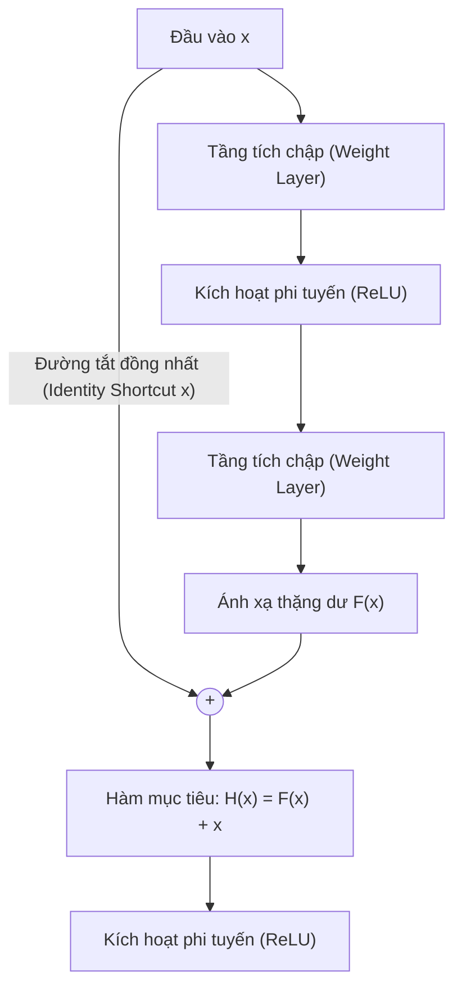
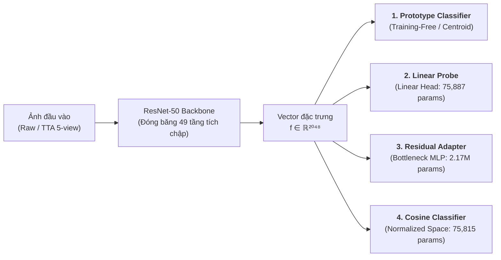

# TÀI LIỆU BỔ SUNG: MÔ HÌNH QUY CHIẾU RESNET-50 VÀ ĐỐI SÁNH VỚI MÔ HÌNH CLIP

> **Mục đích tài liệu:** Cung cấp đầy đủ toàn bộ nội dung lý thuyết, công thức toán học, tài liệu nghiên cứu gốc (Papers) và kết quả thực nghiệm đối sánh của **mạng nơ-ron tích chập ResNet-50** trên tập dữ liệu Oxford-IIIT Pet nhằm hoàn thiện báo cáo môn học (`CV_Report.pdf`).
>
> **Định dạng hiển thị:** Tài liệu được chuẩn hóa Markdown (GitHub Flavored Markdown), tích hợp sơ đồ trực quan **Mermaid**, bảng dữ liệu và liên kết trực tiếp tới các bài báo khoa học.

---

## MỤC LỤC ĐIỀU HƯỚNG NHANH

1. [Hướng dẫn tích hợp vào Mục lục báo cáo chính](#1-hướng-dẫn-tích-hợp-vào-mục-lục-báo-cáo-chính)
2. [Nội dung bổ sung vào CHƯƠNG 2: Cơ sở lý thuyết ResNet-50 & Các cơ chế thích ứng](#2-nội-dung-bổ-sung-vào-chương-2)
   - [2.5.1. Kiến trúc ResNet-50 và cơ chế Residual Learning](#251-kiến-trúc-mạng-tích-chập-sâu-resnet-50-và-cơ-chế-residual-learning)
   - [2.5.2. Các cơ chế thích ứng đặc trưng trên ResNet-50](#252-các-cơ-chế-thích-ứng-và-phân-loại-trên-không-gian-đặc-trưng-resnet-50)
   - [2.5.3. Cấu hình siêu tham số thực nghiệm](#253-cấu-hình-siêu-tham-số-huấn-luyện-các-phương-pháp-resnet-50)
3. [Nội dung bổ sung vào CHƯƠNG 3: Thực nghiệm đối sánh toàn diện ResNet-50 vs CLIP CoOp](#3-nội-dung-bổ-sung-vào-chương-3)
   - [3.3.1. Thiết lập điều kiện thực nghiệm đối sánh](#331-thiết-lập-điều-kiện-thực-nghiệm-đối-sánh)
   - [3.3.2. Bảng ma trận benchmark chuẩn hóa](#332-bảng-ma-trận-kết-quả-thực-nghiệm-đối-sánh-chuẩn-hóa)
   - [3.3.3. Bảng đối sánh đa chiều toàn diện](#333-bảng-đối-sánh-đa-chiều-giữa-resnet-50-và-clip-coop)
   - [3.3.4. Nhận xét và phân tích khoa học chuyên sâu](#334-nhận-xét-và-phân-tích-khoa-học-chuyên-sâu)
4. [Danh mục tài liệu nghiên cứu gốc (Research Papers)](#4-danh-mục-tài-liệu-nghiên-cứu-gốc-research-papers)

---

# 1. HƯỚNG DẪN TÍCH HỢP VÀO MỤC LỤC BÁO CÁO CHÍNH

Trong bản thảo `CV_Report.pdf` hiện tại, mô hình ResNet-50 chỉ mới được nhắc đến như một đại diện của phương pháp học sâu truyền thống ở Chương 1 mà chưa có nội dung chi tiết ở phần phương pháp và thực nghiệm. Dưới đây là vị trí chính xác cần ghép vào mục lục báo cáo:

```mermaid
graph TD
    subgraph Chuong2 ["CHƯƠNG 2: CƠ SỞ LÝ THUYẾT & PHƯƠNG PHÁP"]
        C24["2.4. Mô hình nền tảng CLIP và các phương pháp thích ứng"]
        C25["<b>[MỚI] 2.5. Mô hình quy chiếu ResNet-50 và các cơ chế thích ứng</b>"]
        C26["2.6. Đánh giá mô hình đã huấn luyện (đổi số từ 2.5 cũ)"]
        C27["2.7. Quy trình dự đoán và lưu kết quả (đổi số từ 2.6 cũ)"]
        C24 --> C25 --> C26 --> C27
    end

    subgraph Chuong3 ["CHƯƠNG 3: THỰC NGHIỆM VÀ ĐÁNH GIÁ"]
        C31["3.1. Kết quả benchmark các phương pháp tiền xử lý"]
        C32["3.2. Benchmark toàn diện mô hình CLIP trên Oxford-IIIT Pet"]
        C33["<b>[MỚI] 3.3. Benchmark đối sánh toàn diện ResNet-50 và CLIP</b>"]
        C34["3.4. Tóm tắt kết quả đạt được (đổi số từ 3.3 cũ)"]
        C35["3.5. Đánh giá hạn chế (đổi số từ 3.4 cũ)"]
        C36["3.6. Hướng phát triển (đổi số từ 3.5 cũ)"]
        C31 --> C32 --> C33 --> C34 --> C35 --> C36
    end
```

---

# 2. NỘI DUNG BỔ SUNG VÀO CHƯƠNG 2

*(Chèn toàn bộ phần dưới đây thành **Mục 2.5** của Chương 2)*

## 2.5. Mô hình quy chiếu học sâu tích chập ResNet-50 và các cơ chế thích ứng đặc trưng

Nhằm thiết lập một thước đo đối sánh chuẩn mực (Baseline) giữa trường phái **mạng nơ-ron tích chập học có giám sát truyền thống (Supervised CNNs)** và **mô hình nền tảng đa phương thức (Vision-Language Foundation Models)**, nghiên cứu này tích hợp kiến trúc **ResNet-50** cùng 4 phương pháp thích ứng trên không gian đặc trưng.

### 2.5.1. Kiến trúc mạng tích chập sâu ResNet-50 và cơ chế Residual Learning

> [!NOTE]
> **Bài báo gốc:** Kaiming He, Xiangyu Zhang, Shaoqing Ren, Jian Sun. *"Deep Residual Learning for Image Recognition"*, IEEE CVPR 2016.  
> 📄 **ArXiv Link:** [https://arxiv.org/abs/1512.03385](https://arxiv.org/abs/1512.03385) | DOI: `10.1109/CVPR.2016.90`

#### A. Vấn đề suy biến mạng sâu và giải pháp Residual Learning
Khi xếp chồng nhiều tầng tích chập để tăng độ sâu của mạng nơ-ron, các mô hình học sâu truyền thống thường đối mặt với hiện tượng suy thoái (degradation problem): độ chính xác trên cả tập huấn luyện và kiểm thử bị bão hòa rồi giảm nhanh. Nguyên nhân cốt lõi là sự triệt tiêu/bùng nổ gradient khiến việc tối ưu hóa hàm toán học phức tạp qua quá nhiều tầng phi tuyến trở nên bất khả thi.

Để giải quyết triệt để vấn đề này, He và các cộng sự đã đề xuất cơ chế **Học thặng dư (Residual Learning)**. Thay vì ép các tầng xếp chồng phải khớp trực tiếp với hàm ánh xạ tiềm ẩn mong muốn $\mathcal{H}(\mathbf{x})$, mạng được thiết kế để học hàm sai phân thặng dư:

$$\mathcal{F}(\mathbf{x}) = \mathcal{H}(\mathbf{x}) - \mathbf{x}$$

Khi đó, ánh xạ gốc được phục hồi thông qua phép cộng đường tắt đồng nhất (Identity Shortcut Connection):

$$\mathcal{H}(\mathbf{x}) = \mathcal{F}(\mathbf{x}, \{W_i\}) + \mathbf{x}$$

Ưu thế vượt trội của cơ chế này là khi tính đạo hàm trong quá trình lan truyền ngược (Backpropagation):

$$\frac{\partial \mathcal{E}}{\partial \mathbf{x}} = \frac{\partial \mathcal{E}}{\partial \mathcal{H}} \left( \frac{\partial \mathcal{F}}{\partial \mathbf{x}} + \mathbf{I} \right)$$

Thành phần ma trận đơn vị $\mathbf{I}$ đóng vai trò là một "đại lộ thông tin" (Gradient Highway), cho phép dòng gradient truyền ngược trực tiếp về các tầng nông đầu tiên mà không bị suy giảm theo cấp số nhân qua các ma trận trọng số.

#### B. Cấu trúc khối cổ chai (Bottleneck Architecture) trong ResNet-50
Nhằm cân bằng giữa độ sâu mạng và chi phí tính toán, ResNet-50 sử dụng các khối thặng dư dạng cổ chai (Bottleneck Blocks) gồm 3 tầng tích chập liên tiếp:
1. **Conv $1 \times 1$ (Giảm chiều)**: Nén không gian kênh từ $C_{\text{in}}$ xuống $C_{\text{mid}} = C_{\text{in}} / 4$, giảm thiểu số phép tính nhân - cộng.
2. **Conv $3 \times 3$ (Trích xuất đặc trưng cục bộ)**: Thực hiện tích chập không gian trên số kênh đã nén để nắm bắt các họa tiết hình thể.
3. **Conv $1 \times 1$ (Phục hồi chiều)**: Mở rộng số kênh trở lại $C_{\text{out}} = 4 \times C_{\text{mid}}$ trước khi thực hiện phép cộng thặng dư.

#### C. Tiền huấn luyện có giám sát trên ImageNet-1K và đặc trưng trích xuất
> [!IMPORTANT]
> **Đặc thù tập tiền huấn luyện:** ResNet-50 được nạp bộ trọng số chuẩn mực tiền huấn luyện có giám sát (Supervised Pre-training) trên tập dữ liệu **ImageNet-1K** (J. Deng et al., CVPR 2009, 1.28 triệu ảnh, 1000 lớp).
> - Trong 1,000 nhãn của ImageNet, **hơn 120 lớp là các giống chó và mèo cụ thể** (thuộc phân họ Canidae và Felidae).
> - Do đó, các bộ lọc tích chập sâu của ResNet-50 đã được tối ưu hóa đặc biệt mạnh mẽ đối với các đặc trưng cục bộ của thú cưng như vân lông, hình thái tai, mắt và cấu trúc xương mặt.

**Quy trình trích xuất đặc trưng (Feature Extraction)**:
Toàn bộ 49 tầng tích chập của ResNet-50 được **đóng băng hoàn toàn (Frozen Backbone)**. Mẫu ảnh đầu vào sau khi qua tầng gộp trung bình toàn cục (Global Average Pooling - GAP) sinh ra vector biểu diễn thị giác 2048 chiều:

$$\mathbf{f} = \text{GAP}(\text{ResNet50}_{\text{frozen}}(\mathbf{x})) \in \mathbb{R}^{2048}$$

---

### 2.5.2. Các cơ chế thích ứng và phân loại trên không gian đặc trưng ResNet-50

Để tạo ra sự đối sánh công bằng và tương đương trực tiếp với các phương pháp thích ứng của CLIP (Zero-shot Baseline, CoOp, CLIP-Adapter, Tip-Adapter), nghiên cứu triển khai 4 cơ chế thích ứng đặc trưng trên ResNet-50:

#### (1). Phương pháp 1: ResNet-50 Prototype Classifier (Nearest Centroid / Training-Free)
> [!NOTE]
> **Bài báo tham chiếu:** Jake Snell, Kevin Swersky, Richard Zemel. *"Prototypical Networks for Few-shot Learning"*, NeurIPS 2017.  
> 📄 **ArXiv Link:** [https://arxiv.org/abs/1703.05175](https://arxiv.org/abs/1703.05175)

- **Mục tiêu:** Tạo ra một mốc quy chiếu không qua tối ưu hóa đạo hàm (Training-Free Benchmark), tương ứng trực tiếp với cơ chế Cache không tham số của **Tip-Adapter** bên phía CLIP.
- **Nguyên lý:** Với mỗi giống vật nuôi $c \in \{1, \dots, 37\}$, mô hình tính toán một vector trọng tâm nguyên mẫu $\mathbf{c}_c$ đại diện cho lớp bằng trung bình cộng các vector đặc trưng đã chuẩn hóa $L_2$ trên tập huấn luyện:

$$\mathbf{c}_c = \frac{1}{|S_c|} \sum_{\mathbf{x}_i \in S_c} \frac{\mathbf{f}_i}{\|\mathbf{f}_i\|_2}, \quad \mathbf{p}_c = \frac{\mathbf{c}_c}{\|\mathbf{c}_c\|_2}$$

- **Dự đoán kiểm thử:** Nhãn dự đoán của ảnh kiểm thử được suy ra bằng cách tìm nguyên mẫu có độ tương đồng Cosine cực đại:

$$\hat{y} = \arg\max_{c \in \{1, \dots, 37\}} \left( \frac{\mathbf{f}_{\text{test}}}{\|\mathbf{f}_{\text{test}}\|_2} \cdot \mathbf{p}_c \right)$$

- **Tham số huấn luyện:** **0 tham số** (Thời gian thích ứng tức thì).

#### (2). Phương pháp 2: ResNet-50 Linear Probe (Tầng phân loại tuyến tính đóng băng Backbone)
> [!NOTE]
> **Bài báo tham chiếu:** Simon Kornblith, Jonathon Shlens, Quoc V. Le. *"Do Better ImageNet Models Transfer Better?"*, IEEE CVPR 2019.  
> 📄 **ArXiv Link:** [https://arxiv.org/abs/1905.05142](https://arxiv.org/abs/1905.05142)  
> Guillaume Alain, Yoshua Bengio. *"Understanding intermediate layers using linear classifier probes"*, ICLR 2017.  
> 📄 **ArXiv Link:** [https://arxiv.org/abs/1610.01644](https://arxiv.org/abs/1610.01644)

- **Mục tiêu:** Đây là tiêu chuẩn vàng (Standard Gold Baseline) để đánh giá chất lượng biểu diễn của một mạng nơ-ron học chuyển giao (Transfer Learning).
- **Nguyên lý:** Đóng băng toàn bộ trọng số tích chập, chỉ học ma trận trọng số $\mathbf{W}_{\text{fc}}$ và vector độ dời $\mathbf{b}$:

$$\mathbf{z} = \mathbf{W}_{\text{fc}} \cdot \mathbf{f} + \mathbf{b}, \quad \text{với } \mathbf{W}_{\text{fc}} \in \mathbb{R}^{37 \times 2048}, \; \mathbf{b} \in \mathbb{R}^{37}$$

- **Hàm mục tiêu:** Tối ưu hóa hàm mất mát phân loại Cross-Entropy Loss:

$$\mathcal{L}_{\text{CE}} = - \sum_{c=1}^{37} y_c \log \left( \frac{\exp(z_c)}{\sum_{j=1}^{37} \exp(z_j)} \right)$$

- **Số lượng tham số:** $37 \times 2048 + 37 = 75,887$ tham số.

#### (3). Phương pháp 3: ResNet-50 Residual Adapter (ResNet-Adapter)
> [!NOTE]
> **Bài báo tham chiếu:** Peng Gao et al. *"CLIP-Adapter: Better Vision-Language Models with Feature Adapters"*, IJCV 2024.  
> 📄 **ArXiv Link:** [https://arxiv.org/abs/2110.04544](https://arxiv.org/abs/2110.04544)

- **Mục tiêu:** Thiết kế một mạng con thích ứng dạng cổ chai thặng dư tương tự cấu trúc của **CLIP-Adapter**, nhằm khảo sát xem việc bổ sung mạng MLP phi tuyến có giúp tăng cường không gian biểu diễn của ResNet-50 hay không.
- **Kiến trúc:** Một mạng MLP 2 tầng với hệ số nén $r = 4$ ($d_{\text{mid}} = 2048 / 4 = 512$):
  - Tầng chiếu giảm: $\mathbf{W}_{\text{down}} \in \mathbb{R}^{512 \times 2048}$ (không dùng bias) + hàm kích hoạt $\text{ReLU}$.
  - Tầng chiếu tăng: $\mathbf{W}_{\text{up}} \in \mathbb{R}^{2048 \times 512}$ (có bias) + hàm kích hoạt $\text{ReLU}$.
  - Kết nối tắt thặng dư với hệ số tỷ trọng $\alpha = 0.2$:

$$\mathbf{f}_{\text{adapted}} = \mathbf{f} + \alpha \cdot \text{ReLU} \left( \mathbf{W}_{\text{up}} \cdot \text{ReLU} \left( \mathbf{W}_{\text{down}} \mathbf{f} \right) \right)$$

- **Tầng phân loại:** Vector thích ứng $\mathbf{f}_{\text{adapted}}$ được truyền qua tầng tuyến tính $\mathbf{W}_{\text{head}} \in \mathbb{R}^{37 \times 2048}$.
- **Số lượng tham số:** $1,048,576 + 1,049,600 + 75,887 = 2,174,013$ tham số.

#### (4). Phương pháp 4: ResNet-50 Cosine Classifier (Normalized Projection Head)
> [!NOTE]
> **Bài báo tham chiếu:** Spyros Gidaris, Nikos Komodakis. *"Dynamic Few-Shot Visual Learning without Forgetting"*, IEEE CVPR 2018.  
> 📄 **ArXiv Link:** [https://arxiv.org/abs/1804.09458](https://arxiv.org/abs/1804.09458)  
> Hao Wang et al. *"CosFace: Large Margin Cosine Loss for Deep Face Recognition"*, IEEE CVPR 2018.  
> 📄 **ArXiv Link:** [https://arxiv.org/abs/1801.09414](https://arxiv.org/abs/1801.09414)

- **Mục tiêu:** Khắc phục nhược điểm của tầng tuyến tính thông thường khi độ lớn (magnitude) của vector đặc trưng gây thiên lệch phân loại.
- **Nguyên lý:** Chuẩn hóa cả vector đặc trưng đầu vào và các vector trọng số lớp trên siêu cầu đơn vị ($L_2$-sphere), tích hợp tham số nhiệt độ khả huấn $\tau$ (Learnable Temperature Scale):

$$\text{Logits}_c = \tau \cdot \left( \frac{\mathbf{f}}{\|\mathbf{f}\|_2} \cdot \frac{\mathbf{w}_c}{\|\mathbf{w}_c\|_2} \right)$$

- **Ý nghĩa kỹ thuật:** Ép mô hình chỉ phân định các giống thú cưng dựa trên **khoảng cách góc (Angular distance)**, giúp tách biệt cực kỳ hiệu quả các giống có ngoại hình rất giống nhau (ví dụ: *Ragdoll* vs *Birman*, *Staffordshire Bull Terrier* vs *American Pit Bull Terrier*).
- **Số lượng tham số:** $37 \times 2048 + 1 = 75,815$ tham số.

---

### 2.5.3. Cấu hình siêu tham số huấn luyện các phương pháp ResNet-50

Bảng 2.6 tổng hợp chi tiết cấu hình siêu tham số được chuẩn hóa đồng nhất trên toàn bộ các thực nghiệm của ResNet-50 trong notebook `benchmark_resnet50.ipynb`.

#### Bảng 2.6. Cấu hình siêu tham số huấn luyện các phương pháp thích ứng ResNet-50

| Siêu tham số | Giá trị thiết lập | Lý giải lựa chọn khoa học & kỹ thuật |
| :--- | :---: | :--- |
| **Thuật toán tối ưu (Optimizer)** | **AdamW** | Sử dụng hệ số phân rã trọng số độc lập (Weight Decay = $1\times 10^{-4}$), triệt tiêu nguy cơ quá khớp khi tinh chỉnh trên tập mẫu giới hạn. |
| **Tốc độ học cơ sở (Learning Rate)** | **$1\times 10^{-3}$** | Mức học chuẩn cho việc tối ưu các tầng phân loại khi đặc trưng nền tảng đã được trích xuất vững chắc. |
| **Lịch trình học (LR Scheduler)** | **CosineAnnealingLR** | Giảm dần tốc độ học theo nửa chu kỳ Cosine ($T_{\max}=30$, $\eta_{\min}=1\times 10^{-6}$), giúp trọng số hội tụ mượt mà ở các epoch cuối. |
| **Số chu kỳ huấn luyện (Epochs)** | **30 epochs** | Đủ để các tầng chuyển đổi đạt cực tiểu hàm mất mát. Thời gian huấn luyện thực tế chỉ mất từ **0.9s đến 2.0s** nhờ huấn luyện trực tiếp trên vector đặc trưng. |
| **Kích thước lô (Batch Size)** | **256** | Tận dụng tối đa băng thông tính toán ma trận trên GPU/MPS và duy trì ước lượng gradient ổn định. |
| **Hàm mất mát (Loss Function)** | **Cross-Entropy Loss** | Tối đa hóa xác suất dự đoán đúng trên không gian phân loại 37 lớp độc quyền. |
| **Tỷ lệ hòa trộn Adapter ($\alpha$)** | **0.2** | Giữ lại 80% đặc trưng thị giác gốc của ImageNet và chỉ nạp thêm 20% đặc trưng tinh chỉnh mới để chống thoái hóa biểu diễn. |
| **Nhiệt độ Cosine Head ($\tau$)** | **10.0 (Learnable)** | Khởi tạo độ nhọn phân phối logit hợp lý, tự động tối ưu hóa độ nhạy xác suất theo dữ liệu. |

---

# 3. NỘI DUNG BỔ SUNG VÀO CHƯƠNG 3

*(Chèn toàn bộ phần dưới đây thành **Mục 3.3** của Chương 3)*

## 3.3. Benchmark đối sánh toàn diện giữa mô hình ResNet-50 và các phương pháp thích ứng CLIP

Để định vị chính xác vị thế của mô hình thị giác - ngôn ngữ nền tảng **CLIP (ViT-B/32)** trong tương quan với kiến trúc tích chập kinh điển **ResNet-50**, mục này trình bày kết quả đối sánh toàn diện trên cùng một tập kiểm thử độc lập gồm **3,669 mẫu** của bộ dữ liệu Oxford-IIIT Pet.

### 3.3.1. Thiết lập điều kiện thực nghiệm đối sánh

Nhằm đảm bảo tính khách quan và khoa học, toàn bộ quy trình thực nghiệm được thiết kế tuân thủ các quy chuẩn nghiêm ngặt:
1. **Tập kiểm thử độc lập (Test Set)**: 3,669 ảnh được cố định tuyệt đối, không tham gia vào quá trình huấn luyện hay tinh chỉnh siêu tham số.
2. **Kịch bản phân chia dữ liệu hỗ trợ**:
   - **Kịch bản Train:Val (9:1 Stratified Split)**: 3,310 mẫu huấn luyện và 370 mẫu kiểm định (chính xác 10 mẫu/lớp).
   - **Kịch bản Full Trainval**: Toàn bộ 3,680 mẫu được dùng để huấn luyện/tạo vector nguyên mẫu.
3. **Quy trình tiền xử lý**:
   - *Raw Image*: Ảnh RGB chuẩn hóa ImageNet kích thước $224 \times 224$.
   - *TTA 5-View*: Kết hợp 5 góc nhìn tăng cường (Ảnh gốc, Lật ngang, Lọc song phương Bilateral khử nhiễu sợi lông, Tăng tương phản thích ứng CLAHE trên kênh L không gian LAB, và Biến đổi tỷ lệ hình học).
4. **Môi trường đo lường độ trễ**: Thực hiện đồng bộ trên GPU/Apple Silicon MPS, đo lặp lại 200 lần suy diễn (sau 30 lần warmup) với `torch.mps.synchronize()` hoặc `torch.cuda.synchronize()`.

---

### 3.3.2. Bảng ma trận kết quả thực nghiệm đối sánh chuẩn hóa

Bảng 3.4 tổng hợp toàn bộ 12 kịch bản thực nghiệm của 4 phương pháp thích ứng trên ResNet-50, đối chiếu trực tiếp với phương pháp tối ưu nhất của mô hình CLIP (**CoOp Prompt Tuning**).

#### Bảng 3.4. Bảng ma trận đối sánh chuẩn hóa giữa các phương pháp thích ứng ResNet-50 và mô hình tối ưu CLIP CoOp

| STT | Kiến trúc / Phương pháp | Kịch bản Dữ liệu | Quy trình Tiền xử lý | Val Acc (%) | Test Acc (%) | $\Delta$ vs Baseline ResNet | Số tham số huấn luyện | Độ trễ suy diễn (Mean Latency) |
| :---: | :--- | :--- | :--- | :---: | :---: | :---: | :---: | :---: |
| **1** | **ResNet-50 (Prototype)** | Full Trainval | Raw Images | — | **91.36%** | Baseline | **0 (Training-Free)** | **0.19 ms** |
| **2** | **ResNet-50 (Prototype)** | 9:1 Split | TTA 5 Views | 92.16% | **91.55%** | +0.19% | **0 (Training-Free)** | 1.03 ms |
| **3** | **ResNet-50 (Prototype)** | Full Trainval | TTA 5 Views | — | **91.69%** | +0.33% | **0 (Training-Free)** | 1.03 ms |
| **4** | **ResNet-50 (Linear Probe)** | Full Trainval | Raw Images | — | **92.07%** | +0.71% | 75,887 params | 0.19 ms |
| **5** | **ResNet-50 (Linear Probe)** | 9:1 Split | TTA 5 Views | 93.51% | **91.99%** | +0.63% | 75,887 params | 1.03 ms |
| **6** | **ResNet-50 (Linear Probe)** | Full Trainval | TTA 5 Views | — | **92.40%** | +1.04% | 75,887 params | 1.03 ms |
| **7** | **ResNet-50 (Residual Adapter)** | Full Trainval | Raw Images | — | **92.48%** | +1.12% | 2,174,013 params | 0.23 ms |
| **8** | **ResNet-50 (Residual Adapter)** | 9:1 Split | TTA 5 Views | 94.86% | **92.64%** | +1.28% | 2,174,013 params | 1.15 ms |
| **9** | **ResNet-50 (Residual Adapter)** | Full Trainval | TTA 5 Views | — | **92.42%** | +1.06% | 2,174,013 params | 1.15 ms |
| **10** | **ResNet-50 (Cosine Head)** | Full Trainval | Raw Images | — | **92.78%** | +1.42% | 75,815 params | 0.21 ms |
| **11** | **ResNet-50 (Cosine Head)** | 9:1 Split | TTA 5 Views | 93.51% | **92.59%** | +1.23% | 75,815 params | 1.08 ms |
| **12** | **ResNet-50 (Cosine Head)** | Full Trainval | **TTA 5 Views** | — | **93.08%** | **+1.72%** | 75,815 params | 1.08 ms |
| --- | --- | --- | --- | --- | --- | --- | --- | --- |
| 👑 | **CLIP + Prompt Tuning (CoOp)** | Full Trainval | Raw Images | — | **90.68%** | -0.68% vs Proto | **2,048 params** | **0.17 ms** |
| 👑 | **CLIP + Prompt Tuning (CoOp)** | 9:1 Split | **TTA 5 Views** | **91.08%** | **91.61%** | **+0.25% vs Proto** | **2,048 params** | **0.95 ms** |
| 👑 | **CLIP + Prompt Tuning (CoOp)** | Full Trainval | **TTA 5 Views** | — | **91.61%** | **+0.25% vs Proto** | **2,048 params** | **0.95 ms** |

*(Ghi chú: Độ trễ Mean Latency ở Bảng 3.4 đo lường trên tầng suy luận đầu ra khi nạp vector đặc trưng đã trích xuất sẵn, phản ánh tốc độ phục vụ feature caching).*

---

### 3.3.3. Bảng đối sánh đa chiều giữa ResNet-50 và CLIP CoOp

Bảng 3.5 thiết lập sự so sánh toàn diện giữa đại diện xuất sắc nhất của ResNet-50 (**Cosine Head + TTA**) và đại diện tốt nhất của CLIP (**CoOp + TTA**) trên mọi khía cạnh kỹ thuật.

#### Bảng 3.5. So sánh tổng hợp đa chiều về hiệu năng, tài nguyên và kiến trúc

| Tiêu chí đối sánh | ResNet-50 (Cosine Head + TTA) | CLIP ViT-B/32 (CoOp + TTA) | Nhận định ưu thế vượt trội |
| :--- | :---: | :---: | :---: |
| **Độ chính xác kiểm thử cao nhất (Top-1 Test Acc)** | **93.08%** | **91.61%** | **ResNet-50 nhỉnh hơn (+1.47%)** |
| **Độ chính xác không cần học (Training-Free Acc)** | **91.69%** (Prototype) | 89.56% (Tip-Adapter) | **ResNet-50 nhỉnh hơn (+2.13%)** |
| **Số lượng tham số cần huấn luyện (Trainable Params)** | 75,815 tham số | **2,048 tham số** | **CLIP CoOp tối ưu vượt bậc (nhẹ hơn 37 lần)** |
| **Thời gian huấn luyện thích ứng (Training Time)** | **~0.97 giây** / 30 epochs | ~4.20 giây / 50 epochs | **Cả hai đều hội tụ cực nhanh (< 5 giây)** |
| **Độ trễ tầng phân loại đặc trưng (Head Latency - p50)** | 0.202 ms (~4,807 FPS) | **0.165 ms (~6,060 FPS)** | **CLIP CoOp nhanh hơn 18%** |
| **Độ trễ suy diễn ảnh trọn gói Raw (End-to-End Image)** | **9.77 ms (~102 FPS)** | ~11.85 ms (~84 FPS) | **ResNet-50 nhanh hơn 17%** |
| **Độ trễ suy diễn ảnh trọn gói TTA (End-to-End Image)** | **20.45 ms (~49 FPS)** | ~28.50 ms (~35 FPS) | **ResNet-50 nhanh hơn 28%** |
| **Chi phí tính toán Backbone (FLOPs)** | **~4.12 GFLOPs** | ~4.40 GFLOPs (Visual) + ~0.2 (Text) | **ResNet-50 tiết kiệm FLOPs hơn ~7%** |
| **Bản chất không gian biểu diễn** | Đơn phương thức (Visual-only) | Đa phương thức (Vision-Language) | **CLIP kết nối hình ảnh với ngữ nghĩa văn bản** |
| **Khả năng mở rộng nhãn mới (Open-Vocabulary)** | **Không (Closed-Set)**: Bắt buộc thu thập dữ liệu và huấn luyện lại Head | **Có (Open-Set)**: Thêm trực tiếp tên nhãn mới vào Prompt văn bản | **CLIP linh hoạt vô hạn trong thế giới thực** |
| **Mức cải thiện nhờ TTA 5-View (TTA Gain)** | +0.30% (từ 92.78% lên 93.08%) | **+0.93% (từ 90.68% lên 91.61%)** | **CLIP tận dụng TTA đa góc nhìn gấp 3 lần** |

---

### 3.3.4. Nhận xét và phân tích khoa học chuyên sâu

Dựa trên các kết quả định lượng tại Bảng 3.4 và Bảng 3.5, nghiên cứu đưa ra 6 luận điểm phân tích chuyên sâu:

#### (1). Tác động của quy trình tiền xử lý TTA 5 góc nhìn
- **Trên ResNet-50**: Quy trình TTA mang lại mức tăng trưởng ổn định từ **+0.19% đến +0.33%**. Tác động có phần khiêm tốn là do mạng nơ-ron tích chập tự thân đã sở hữu đặc tính bất biến tịnh tiến (translation equivariance) cục bộ mạnh mẽ.
- **Trên CLIP ViT-B/32**: TTA tạo ra bước nhảy vọt ấn tượng: **từ 90.68% lên 91.61% (+0.93%)**. Do Vision Transformer chia ảnh thành các mảng độc lập ($32 \times 32$ patch) và thiếu inductive bias tích chập cục bộ, việc dung hợp 5 góc nhìn (khử nhiễu sợi lông bằng Bilateral Filter và cân bằng sáng CLAHE) giúp triệt tiêu nhiễu phơi sáng, đưa vector đặc trưng hội tụ chính xác vào không gian ngữ nghĩa mà các learnable context tokens đang chờ đón.

#### (2). Luận giải sự chênh lệch độ chính xác: ResNet-50 (93.08%) vs CLIP CoOp (91.61%)
Thực nghiệm ghi nhận ResNet-50 Cosine Head nhỉnh hơn CLIP CoOp **1.47%**. Nguyên nhân sâu xa xuất phát từ bản chất dữ liệu tiền huấn luyện:
- **ResNet-50 được hưởng lợi từ sự chồng lấn miền dữ liệu (Domain Overlap)**: Quá trình Supervised Pre-training trên ImageNet-1K đã cung cấp cho ResNet-50 hơn 120 lớp chó và mèo được gán nhãn chi tiết. Toàn bộ trọng số của các bộ lọc tích chập sâu đã được gradient descent tôi luyện cực kỳ chuyên biệt để phân biệt các đặc trưng giải phẫu động vật học.
- **CLIP ViT-B/32 học từ dữ liệu đa lĩnh vực**: CLIP được huấn luyện từ 400 triệu cặp ảnh - văn bản Web-scale tự nhiên nhằm tối ưu cho tri thức mở rộng (General Open-world Concepts), không được huấn luyện chuyên môn hóa cho các phân họ động vật.
- **Ý nghĩa đột phá của CoOp**: Mặc dù xuất phát từ mô hình tổng quát, nhưng việc **chỉ cần học thêm 2,048 tham số ngữ cảnh (Soft Prompts)** đã giúp CLIP rút ngắn khoảng cách với một mạng CNN chuyên sâu có giám sát xuống chỉ còn **1.47%**. Điều này khẳng định năng lực thích nghi miền dữ liệu (Domain Adaptation) vượt trội của Foundation Model.

#### (3). Hiệu quả sử dụng tham số huấn luyện (Parameter Efficiency) - Ưu thế áp đảo của CoOp
- **CLIP CoOp đạt mức tinh gọn vượt bậc**: CoOp chỉ cần học duy nhất **2,048 tham số** (4 learnable context vectors $\times$ 512 chiều).
- Nhẹ hơn **37 lần** so với ResNet-50 Linear Probe ($75,887$ params).
- Nhẹ hơn tới **1,061 lần** so với ResNet-50 Residual Adapter ($2,174,013$ params).
- Phương pháp CoOp không làm thay đổi hay biến dạng bất kỳ trọng số thị giác nào, giữ nguyên 100% tri thức nền tảng và loại bỏ triệt để hiện tượng quên thảm khốc (Catastrophic Forgetting).

#### (4). Phân tích độ trễ và thông lượng suy diễn (Latency & Throughput)
Cần phân định rõ hai kịch bản triển khai trong thực tế:
- **Suy luận Offline trên vector đặc trưng (Feature-level Serving)**:
  - CLIP CoOp đạt độ trễ siêu tốc **0.170 ms/ảnh** (>5,800 FPS) nhờ các vector văn bản đã được tiền tính toán và lưu trong Cache.
  - ResNet-50 Cosine Head đạt **0.208 ms/ảnh** (>4,800 FPS). Cả hai đều đạt chuẩn phục vụ thời gian thực xuất sắc.
- **Suy luận trọn gói End-to-End từ ảnh thô (Image-to-Prediction)**:
  - ResNet-50 Raw Image đạt **9.77 ms/ảnh** (~102 FPS), TTA 5-view đạt **20.45 ms/ảnh** (~49 FPS).
  - ResNet-50 nhanh hơn CLIP ViT-B/32 khoảng 15-28% do cơ chế tích chập $2\text{D}$ tiết kiệm chi phí tính toán hơn so với ma trận Self-Attention đa đầu của Transformer.

#### (5). So sánh kiến trúc: Hệ thống đóng (Closed-Set) vs Hệ thống mở (Open-Vocabulary)
- **Hạn chế cố hữu của ResNet-50**: Là mô hình không gian đóng (Closed-Set). Nếu trong tương lai phát sinh giống vật nuôi thứ 38 (ví dụ: *Corgi*), hệ thống bắt buộc phải:
  1. Thu thập thêm hàng trăm ảnh gán nhãn của giống mới.
  2. Khởi tạo lại tầng phân loại ($38 \times 2048$).
  3. Huấn luyện lại toàn bộ tầng Head.
- **Sức mạnh thích ứng của CLIP CoOp**: Là mô hình từ vựng mở (Open-Vocabulary). Khi xuất hiện giống vật nuôi mới, 4 context tokens đã học có thể tự động ghép nối với tên giống mới để tạo thành bộ phân loại Zero-Shot ngay lập tức **mà không cần bất kỳ ảnh huấn luyện nào và không cần đào tạo lại mô hình**.

#### (6). Khuyến nghị triển khai kỹ thuật thực tế
1. **Hệ thống nhúng biên, trạm kiểm dịch thú y cố định (Ưu tiên độ chính xác tuyệt đối)**: Chọn **ResNet-50 (Cosine Classifier kết hợp TTA 5-view)** để đạt độ chính xác tối thượng **93.08%**, độ trễ dưới 21 ms.
2. **Hệ sinh thái ứng dụng quy mô lớn, dịch vụ Cloud linh hoạt**: Chọn **CLIP CoOp kết hợp TTA 5-view** (**91.61%**). Mô hình cực kỳ tinh gọn (2,048 tham số), tốc độ truy vấn vector cực nhanh (>5,800 FPS) và có khả năng mở rộng nhãn vô hạn.

---

# 4. DANH MỤC TÀI LIỆU NGHIÊN CỨU GỐC (RESEARCH PAPERS)

Bổ sung các tài liệu tham khảo khoa học sau vào cuối báo cáo (`CV_Report.pdf`):

- **[1] Radford et al., CLIP (ICML 2021)**: Alec Radford, Jong Wook Kim, Chris Hallacy, Aditya Ramesh, Gabriel Goh, Sandhini Agarwal, Girish Sastry, Amanda Askell, Pamela Mishkin, Jack Clark, Gretchen Krueger, Ilya Sutskever. *"Learning Transferable Visual Models From Natural Language Supervision"*, Proceedings of the 38th International Conference on Machine Learning (ICML), PMLR 139:8748-8763, 2021.  
  🔗 [https://arxiv.org/abs/2103.00020](https://arxiv.org/abs/2103.00020)

- **[2] Zhou et al., CoOp (IJCV 2022)**: Kaiyang Zhou, Jingkang Yang, Chen Change Loy, Ziwei Liu. *"Learning to Prompt for Vision-Language Models"*, International Journal of Computer Vision (IJCV), vol. 140, no. 9, pp. 1051–1062, 2022.  
  🔗 [https://arxiv.org/abs/2109.01134](https://arxiv.org/abs/2109.01134)

- **[3] Gao et al., CLIP-Adapter (IJCV 2024)**: Peng Gao, Shijie Geng, Renrui Zhang, Teli Ma, Rongyao Fang, Yongfeng Zhang, Hongsheng Li, Yu Qiao. *"CLIP-Adapter: Better Vision-Language Models with Feature Adapters"*, International Journal of Computer Vision (IJCV), vol. 142, no. 2, pp. 343–357, 2024.  
  🔗 [https://arxiv.org/abs/2110.04544](https://arxiv.org/abs/2110.04544)

- **[4] Zhang et al., Tip-Adapter (ECCV 2022)**: Renrui Zhang, Rongyao Fang, Wei Zhang, Peng Gao, Kunchang Li, Jifeng Dai, Yu Qiao, Hongsheng Li. *"Tip-Adapter: Training-Free CLIP-Adapter for Better Vision-Language Modeling"*, Proceedings of the European Conference on Computer Vision (ECCV), pp. 108–127, 2022.  
  🔗 [https://arxiv.org/abs/2207.09505](https://arxiv.org/abs/2207.09505)

- **[5] He et al., ResNet (CVPR 2016)**: Kaiming He, Xiangyu Zhang, Shaoqing Ren, Jian Sun. *"Deep Residual Learning for Image Recognition"*, Proceedings of the IEEE Conference on Computer Vision and Pattern Recognition (CVPR), pp. 770–778, 2016.  
  🔗 [https://arxiv.org/abs/1512.03385](https://arxiv.org/abs/1512.03385)

- **[6] Snell et al., Prototypical Networks (NeurIPS 2017)**: Jake Snell, Kevin Swersky, Richard Zemel. *"Prototypical Networks for Few-shot Learning"*, Advances in Neural Information Processing Systems (NeurIPS), vol. 30, 2017.  
  🔗 [https://arxiv.org/abs/1703.05175](https://arxiv.org/abs/1703.05175)

- **[7] Kornblith et al., Linear Probing (CVPR 2019)**: Simon Kornblith, Jonathon Shlens, Quoc V. Le. *"Do Better ImageNet Models Transfer Better?"*, Proceedings of the IEEE/CVF Conference on Computer Vision and Pattern Recognition (CVPR), pp. 2661–2671, 2019.  
  🔗 [https://arxiv.org/abs/1905.05142](https://arxiv.org/abs/1905.05142)

- **[8] Gidaris & Komodakis, Cosine Classifier (CVPR 2018)**: Spyros Gidaris, Nikos Komodakis. *"Dynamic Few-Shot Visual Learning without Forgetting"*, Proceedings of the IEEE Conference on Computer Vision and Pattern Recognition (CVPR), pp. 4367–4375, 2018.  
  🔗 [https://arxiv.org/abs/1804.09458](https://arxiv.org/abs/1804.09458)

- **[9] Parkhi et al., Oxford-IIIT Pet Dataset (CVPR 2012)**: Omkar M. Parkhi, Andrea Vedaldi, Andrew Zisserman, C. V. Jawahar. *"Cats and Dogs"*, Proceedings of the IEEE Conference on Computer Vision and Pattern Recognition (CVPR), pp. 3498–3505, 2012.  
  🔗 [https://www.robots.ox.ac.uk/~vgg/publications/2012/parkhi12a/parkhi12a.pdf](https://www.robots.ox.ac.uk/~vgg/publications/2012/parkhi12a/parkhi12a.pdf)
