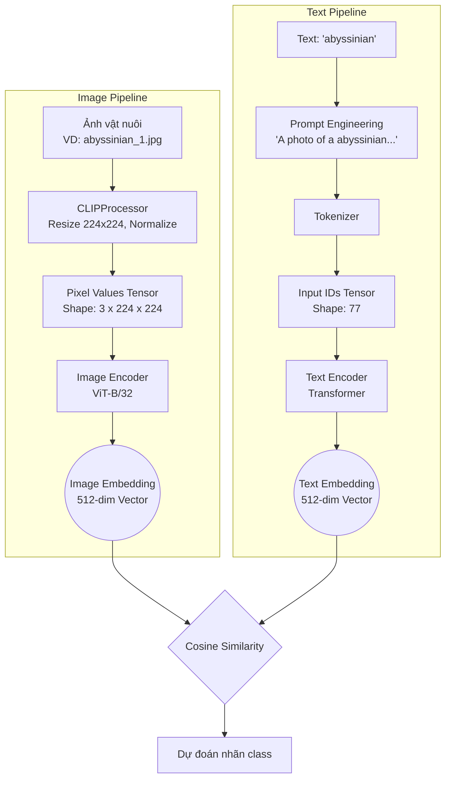

# Báo Cáo Triển Khai Giai Đoạn 1: EDA và Thiết lập Custom Dataset

## 1. Mục tiêu và Tiến độ
Mục tiêu của giai đoạn 1 là làm quen với cấu trúc dữ liệu của Oxford-IIIT Pet, trích xuất dữ liệu mẫu, và viết Custom Dataset của PyTorch tích hợp `CLIPProcessor` để chuẩn bị đưa vào huấn luyện hoặc thử nghiệm zero-shot.

**Tiến độ hiện tại:**
- [x] Đã trích xuất thành công file list nhãn (`annotations/list.txt`)
- [x] Đã trích xuất 30 ảnh mẫu vào thư mục `test_images/`
- [x] Đã thiết lập code khung cho `src/dataset.py`

## 2. Phân tích Dữ liệu (EDA)

### Thông tin cơ bản
- **Nguồn:** Tập dữ liệu Oxford-IIIT Pet.
- **Quy mô:** ~7,349 hình ảnh.
- **Classes:** 37 giống vật nuôi (25 giống chó, 12 giống mèo). Mỗi lớp có khoảng ~200 ảnh.
- **Nội dung:** Ảnh đa dạng về độ chiếu sáng, tư thế vật nuôi, góc chụp và nền. File `list.txt` cung cấp thông tin ID class, chủng loài, và ID giống (breed).

### Quy trình Trích xuất Đặc trưng (Feature Extraction Pipeline)

CLIP có khả năng phân loại zero-shot bằng cách biến đổi ảnh và văn bản thành cùng một chiều Vector (Embedding Space) thông qua 2 bộ mã hoá riêng biệt:

| Dữ liệu thô | Tiền xử lý (Preprocessing) | Định dạng Input cho CLIP | Thành phần Xử lý (Encoder) | Output (Đặc trưng) |
| :--- | :--- | :--- | :--- | :--- |
| **Ảnh (JPEG/PNG)** | Dùng `CLIPProcessor` (hoặc `torchvision`): Resize về 224x224, Center Crop, Normalize (trừ mean, chia std) | **Pixel Values** (Tensor)<br>Shape: `[3, 224, 224]` | **CLIP Image Encoder** (ViT-Base) | **Image Embedding**<br>Vector (D=512) |
| **Tên giống loài** (ví dụ: 'abyssinian') | Gắn vào Text Prompt (VD: *"A photo of a abyssinian, a type of pet"*), sau đó dùng Tokenizer chuyển thành số. | **Input IDs** (Tensor)<br>Shape: `[77]` | **CLIP Text Encoder** (Transformer) | **Text Embedding**<br>Vector (D=512) |

## 3. Sơ đồ xử lý dữ liệu với CLIP



## 4. Hướng dẫn chạy thử nghiệm
Toàn bộ source code phục vụ trích xuất và đọc dataset nằm ở:
- Script giải nén mẫu: `src/extract_sample.py`
- Pipeline PyTorch: `src/dataset.py`

**Lưu ý khi chạy trên máy của bạn:**
Hiện tại môi trường chưa được cài đặt thư viện `torch` và `transformers`. Trước khi chạy `dataset.py`, bạn vui lòng cài đặt các package cần thiết:
```bash
pip install torch torchvision transformers pillow
```
Sau đó chạy lệnh:
```bash
python src/dataset.py
```
Code sẽ tự động khởi tạo processor, trỏ vào ảnh mẫu, load danh sách class và in ra Shape của tensor ảnh (mong đợi: `[3, 224, 224]`).
